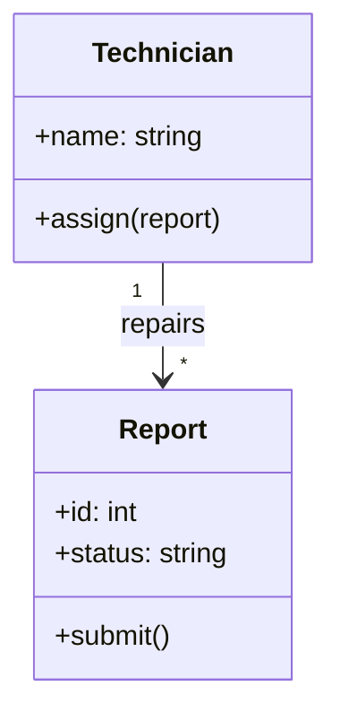

# راهنمای کوتاه همکاری روی گیت‌هاب

مخزن پروژه:  
https://github.com/AmirAref/paya-university-fault-system

چون چند نفری روی پروژه کار می‌کنیم، **هیچ‌کس نباید مستقیم روی برنچ `main` کار کند**.  
هر نفر یک برنچ شخصی می‌سازد و فقط روی همان کار می‌کند.


## ۱. کلون کردن مخزن (فقط یک‌بار)

```bash
git clone https://github.com/AmirAref/paya-university-fault-system.git
cd paya-university-fault-system
```

---

## ۲. ساخت برنچ شخصی

نام برنچ را این‌طور بگذارید (مثال):

```bash
git checkout -b aref-tasks
```

پیشنهاد نام‌گذاری:
- `aref-tasks`
- `arshia-tasks`
- `reza-tasks`

یا هر نامی که مشخص کند مال شماست.

---

## ۳. کار کردن و ذخیره تغییرات

بعد از هر تغییر مهم:

```bash
git status                  # ببین چه فایل‌هایی تغییر کرده‌اند
git add .                   # همه تغییرات را اضافه کن
git commit -m "توضیح کوتاه کار انجام‌شده"
```

مثال پیام کامیت خوب:
- `"افزودن بخش بازیگران به use-case.md"`
- `"اصلاح توضیحات نیازمندی‌های عملکردی"`

---

## ۴. ارسال برنچ به گیت‌هاب

```bash
git push -u origin aref-tasks
```

(فقط بار اول `-u` لازم است. دفعات بعدی فقط `git push` کافی است.)

---

## ۵. ساخت Pull Request (پیشنهاد ادغام)

1. برو به صفحه مخزن روی گیت‌هاب
2. روی دکمه **Compare & pull request** کلیک کن
3. عنوان و توضیح کوتاه بنویس
4. Create pull request را بزن

یکی از اعضا (ترجیحاً بازبین همان بخش) PR را بررسی و در صورت تأیید Merge می‌کند.

---

## ۶. رسم نمودار با Mermaid

برای رسم نمودارها (مثل Class Diagram) از ابزار [Mermaid](https://mermaid.js.org/) استفاده کنید.  
نمودار به‌صورت متن نوشته می‌شود، بنابراین تغییرات آن در Git قابل مشاهده و بازبینی است. گیت‌هاب این نمودارها را مستقیم در فایل‌های `.md` نمایش می‌دهد.

مثال یک Class Diagram:



---

## نکات مهم

- همیشه قبل از شروع کار جدید، آخرین تغییرات `CONTRIBUTINGmain` را بگیر:
  ```bash
  git checkout main
  git pull
  git checkout aref-tasks
  git merge main
  ```
- پیام کامیت را واضح و کوتاه بنویس.
- فقط روی برنچ خودت کار کن.
- اگر گیج شدی یا ارور گرفتی، از بقیه بپرس؛ نگذار مشکل بزرگ شود.

---

اگر مرحله‌ای را متوجه نشدید، تو گروه‌مون بپرسید تا سریع حلش کنیم.
