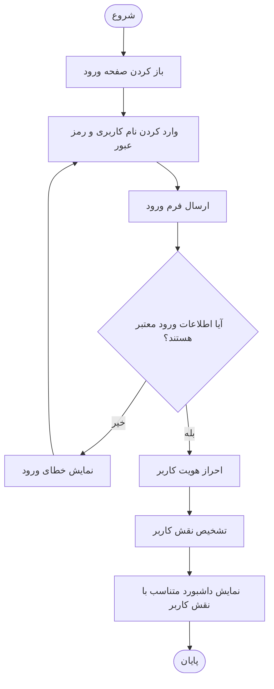
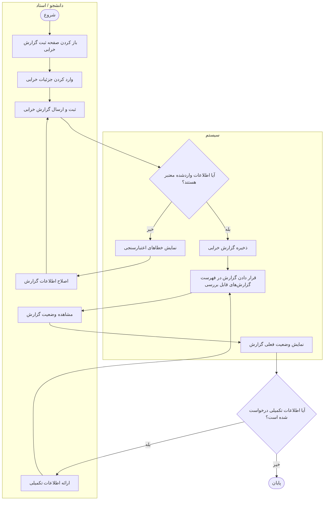
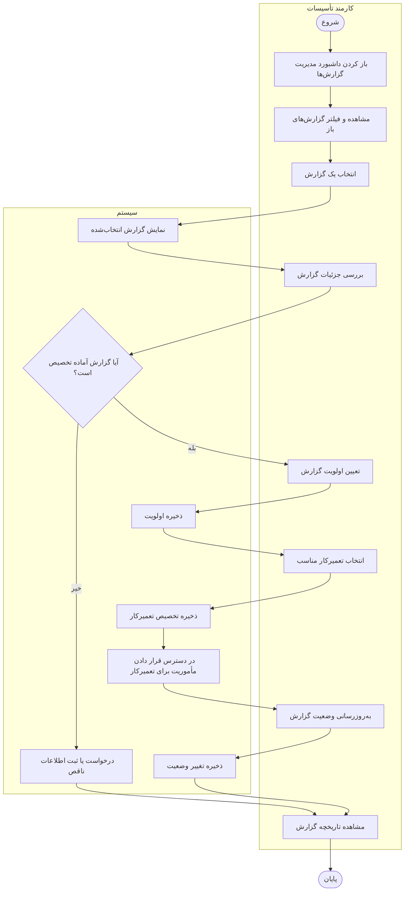
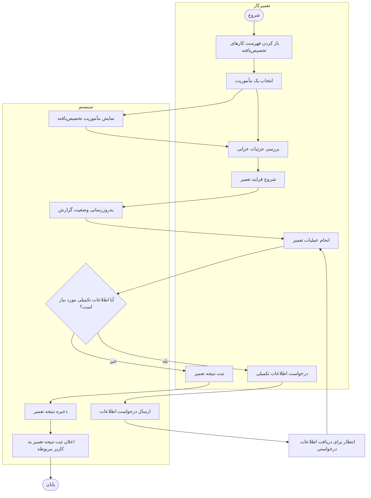
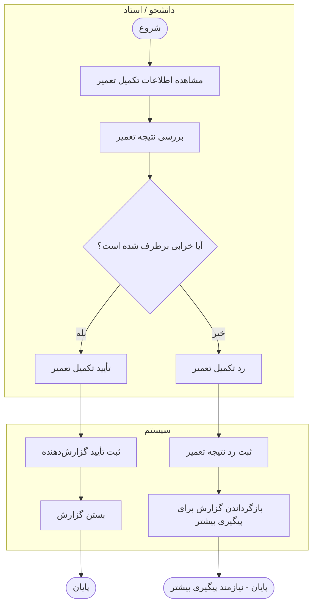
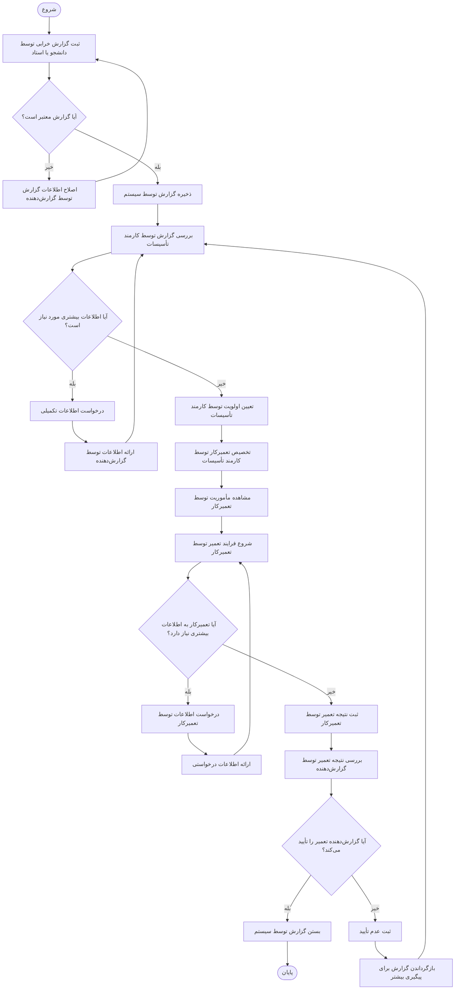

# نمودارهای فعالیت

این سند جریان‌های کاری اصلی سامانه گزارش و مدیریت خرابی‌های دانشگاه را با استفاده از Mermaid نمایش می‌دهد.

> **نکته:** نمودارها بر اساس بازیگران و ۱۷ داستان کاربری شناسایی‌شده در مستندات تحلیل تهیه شده‌اند. جزئیاتی که در نیازمندی‌ها صریحاً مشخص نشده‌اند، به‌عنوان فرض یا پرسش باز علامت‌گذاری شده‌اند و نباید قانون قطعی سیستم تلقی شوند.

## ۱. بازیگران و مسئولیت‌ها

| بازیگر | مسئولیت‌ها |
|---|---|
| دانشجو (Student) | ثبت و پیگیری گزارش خرابی، ارائه اطلاعات تکمیلی و تأیید یا رد نتیجه تعمیر |
| استاد (Professor) | ثبت و پیگیری گزارش خرابی، ارائه اطلاعات تکمیلی و تأیید یا رد نتیجه تعمیر |
| کارمند تأسیسات (Facilities Staff) | بررسی و فیلتر گزارش‌ها، تعیین اولویت، تخصیص تعمیرکار، به‌روزرسانی وضعیت و مشاهده تاریخچه |
| تعمیرکار (Technician) | مشاهده مأموریت‌های تخصیص‌یافته، شروع تعمیر، ثبت نتیجه و درخواست اطلاعات تکمیلی |
| مدیر (Manager) | مشاهده داشبورد مدیریتی؛ سطح دسترسی دقیق این نقش باید در نیازمندی‌ها مشخص شود |
| کاربر سیستم (System User) | عنوان عمومی کاربر احراز هویت‌شده در داستان‌های ورود و اعلان؛ لزوماً یک نقش انسانی مستقل نیست |

## ۲. نمودار فعالیت احراز هویت (Authentication Activity)

**داستان کاربری مرتبط:** US-15 — ورود به سیستم (Log in).

این نمودار فرایند عمومی ورود کاربر را نشان می‌دهد. روش دقیق احراز هویت، بازیابی رمز عبور و سیاست قفل حساب در این بخش مشخص نشده‌اند.

## ۳. نمودار فعالیت ثبت گزارش خرابی (Fault Reporting Activity)

**داستان‌های کاربری مرتبط:**
- US-01 — دانشجو گزارش خرابی ثبت می‌کند.
- US-02 — استاد گزارش خرابی ثبت می‌کند.
- US-03 — دانشجو یا استاد وضعیت گزارش را پیگیری می‌کند.
- US-04 — دانشجو یا استاد اطلاعات تکمیلی ارائه می‌دهد.

دانشجو و استاد از جریان کاری کلی یکسانی برای گزارش خرابی استفاده می‌کنند؛ بنابراین در یک گروه مسئولیت نمایش داده شده‌اند.

**نکته مدل‌سازی:** حلقه اصلاح اطلاعات، اعتبارسنجی فرم را نمایش می‌دهد. باید مشخص شود آیا کاربر می‌تواند در هر زمان اطلاعات تکمیلی ارسال کند یا فقط پس از درخواست کارمند تأسیسات یا تعمیرکار مجاز به این کار است.

## ۴. نمودار فعالیت مدیریت گزارش‌ها (Report Management Activity)

**داستان‌های کاربری مرتبط:**
- US-06 — مشاهده و فیلتر گزارش‌های باز.
- US-07 — تعیین اولویت گزارش.
- US-08 — تخصیص تعمیرکار.
- US-09 — به‌روزرسانی وضعیت گزارش.
- US-10 — مشاهده تاریخچه گزارش.
- US-17 — مشاهده داشبورد توسط کارمند تأسیسات یا مدیر.

**نکته مدل‌سازی:** تصمیم «آیا گزارش آماده تخصیص است؟» یک مرحله پیشنهادی است. شرایط دقیق تخصیص تعمیرکار و نحوه بازگرداندن گزارش‌های ناقص به گزارش‌دهنده باید در نیازمندی‌ها مشخص شوند.

## ۵. نمودار فعالیت تعمیر خرابی (Repair Activity)

**داستان‌های کاربری مرتبط:**
- US-11 — تعمیرکار کارهای تخصیص‌یافته را مشاهده می‌کند.
- US-12 — تعمیرکار تعمیر را آغاز می‌کند.
- US-13 — تعمیرکار نتیجه تعمیر را ثبت می‌کند.
- US-14 — تعمیرکار درخواست اطلاعات تکمیلی می‌دهد.

**نکته مدل‌سازی:** در این نمودار، درخواست اطلاعات تکمیلی باعث توقف موقت تعمیر می‌شود. باید مشخص شود چه کسی اطلاعات را ارائه می‌کند، پس از دریافت اطلاعات چگونه به تعمیرکار اطلاع داده می‌شود و آیا هنگام انتظار وضعیت گزارش تغییر می‌کند یا خیر.

## ۶. نمودار فعالیت تأیید تعمیر (Repair Verification Activity)

**داستان کاربری مرتبط:** US-05 — دانشجو یا استاد تکمیل تعمیر را تأیید یا رد می‌کند.

گزارش‌دهنده نتیجه ثبت‌شده تعمیر را بررسی می‌کند و مشخص می‌کند که آیا خرابی برطرف شده است یا خیر.

**پرسش باز:** نیازمندی‌ها باید مشخص کنند پس از رد نتیجه تعمیر چه اتفاقی می‌افتد: آیا گزارش به کارمند تأسیسات بازمی‌گردد، دوباره به همان تعمیرکار تخصیص داده می‌شود یا فرایند دیگری اجرا می‌شود؟ این نمودار هیچ‌یک از این سیاست‌ها را به‌عنوان تصمیم قطعی انتخاب نمی‌کند.

## ۷. نمودار کلی چرخه عمر گزارش خرابی (Overall Fault Lifecycle)

این نمودار نمایی کلی از فرایند اصلی سیستم ارائه می‌دهد و مراحل ثبت گزارش، مدیریت، تعمیر و تأیید را به یکدیگر متصل می‌کند.

**نکته مدل‌سازی:** بازگشت گزارش ردشده به مرحله بررسی کارمند تأسیسات، یک مسیر پیشنهادی برای پیگیری مجدد است و هنوز سیاست قطعی تخصیص مجدد محسوب نمی‌شود. این مسیر باید با اعضای تیم پروژه بررسی و تأیید شود.

## ۸. پرسش‌ها و ابهام‌های نیازمندی‌ها

موارد زیر باید پیش از نهایی‌شدن نمودارها با اعضای تیم پروژه مشخص شوند:

1. **اعتبارسنجی گزارش:** کدام فیلدها اجباری هستند و چه شرایطی باعث نامعتبر شدن گزارش می‌شود؟
2. **رد گزارش:** آیا کارمند تأسیسات می‌تواند گزارش ثبت‌شده را رد کند؟ در صورت امکان، دلایل و وضعیت‌های مربوط به آن چیست؟
3. **اولویت‌ها:** چه سطوحی برای اولویت وجود دارد و معیار تعیین هر سطح چیست؟
4. **وضعیت‌های گزارش:** فهرست رسمی وضعیت‌ها و انتقال‌های مجاز بین آن‌ها چیست؟
5. **تخصیص تعمیرکار:** آیا یک گزارش می‌تواند به چند تعمیرکار تخصیص داده شود یا در هر لحظه فقط یک تعمیرکار مسئول آن است؟
6. **اطلاعات تکمیلی:** چه افرادی می‌توانند درخواست اطلاعات دریافت کنند و هنگام انتظار برای پاسخ چه اتفاقی می‌افتد؟
7. **تأیید تعمیر:** پس از رد نتیجه تعمیر توسط گزارش‌دهنده، جریان کاری دقیق چیست؟
8. **اعلان‌ها:** کدام رویدادها باعث ارسال اعلان می‌شوند، دریافت‌کنندگان چه کسانی هستند و اعلان‌ها از چه کانالی ارسال می‌شوند؟
9. **دسترسی مدیر:** آیا دسترسی مدیر فقط به مشاهده داشبورد محدود است یا این نقش امکان مدیریت گزارش‌ها را نیز دارد؟
10. **احراز هویت:** آیا قوانین ورود یا کنترل دسترسی برای نقش‌های مختلف متفاوت است؟
