# نمودار کلاس (Class Diagram) – سامانه مدیریت و گزارش خرابی دانشگاهی

**تهیه‌کننده:** امیرحسن عارف اصل  
**بازبین:** ارشیا همتی‌زاده  
**آخرین به‌روزرسانی:** ۱۴۰۵/۰۸/۱۴

---

## مقدمه

این سند نمودار کلاس سامانهٔ مدیریت و گزارش خرابی دانشگاهی را بر اساس مستندات موجود در مخزن ارائه می‌دهد. نمودار حاضر از اسناد زیر استخراج شده است:

- [`README.md`](../../README.md)
- [`user-story.md`](user-story.md)
- [`requirements-specification.md`](requirements-specification.md)
- [`activity.md`](activity.md)
- [`CONTRIBUTING.md`](../../CONTRIBUTING.md)
- فایل‌های Feature: `US-01-report-fault.feature`، `US-05-verify-repair.feature`، `US-15-login.feature`

> **نکته:** چون پروژه هنوز وارد فاز کدنویسی نشده است، این نمودار یک **مدل دامنه (Domain Model)** است و کلاس‌های فنی مانند Repository، Controller و جدول پایگاه‌داده را شامل نمی‌شود. برای مشاهدهٔ مدل دامنهٔ تفصیلی، به `domain-model.md` (در صورت وجود) مراجعه کنید.

## ۱. بازیگران و نقش‌ها در نمودار

| بازیگر | کلاس متناظر | مستند مرجع |
|---|---|---|
| کاربر سیستم | `User` | FR-01، FR-02، US-15، AD-01 |
| گزارش‌دهنده | `Reporter` (انتزاعی) | requirements §۲ |
| دانشجو | `Student` | US-01 تا US-05، AD-02 |
| استاد | `Professor` | US-02 تا US-05، AD-02 |
| کارمند تأسیسات | `FacilitiesStaff` | FR-06 تا FR-09، FR-11، FR-16، FR-17، US-06 تا US-10، US-17، AD-03 |
| تعمیرکار | `Technician` | FR-10 تا FR-13، US-11 تا US-14، AD-04 |
| مدیر | `Manager` | FR-17، US-17، AD-03 |

## ۲. نمودار کلاس

```mermaid
classDiagram
    direction LR

    class User["کاربر سیستم"] {
        +String نام_کاربری
        +String رمز_عبور_هش‌شده
        +Boolean فعال
        +ورود(نام_کاربری, رمز_عبور) Boolean
        +خروج() void
        +بررسی_دسترسی(عملیات) Boolean
    }

    class Reporter["گزارش‌دهنده"] {
        <<abstract>>
        +ثبت_گزارش(عنوان, توضیحات, محل, نوع_تجهیز) FaultReport
        +افزودن_اطلاعات_تکمیلی(گزارش, محتوا) void
        +مشاهده_گزارش‌های_خود() List
        +مشاهده_تاریخچه(گزارش) List
        +تأیید_تعمیر(گزارش) void
        +رد_تعمیر(گزارش, دلیل) void
    }

    class Student["دانشجو"]
    class Professor["استاد"]

    class FacilitiesStaff["کارمند تأسیسات"] {
        +بررسی_گزارش‌ها(فیلتر) List
        +تعیین_اولویت(گزارش, اولویت) void
        +تخصیص_تعمیرکار(گزارش, تعمیرکار) Assignment
        +تغییر_وضعیت(گزارش, وضعیت) void
        +مشاهده_تاریخچه(گزارش) List
        +مشاهده_داشبورد() Dashboard
    }

    class Technician["تعمیرکار"] {
        +مشاهده_مأموریت‌ها() List
        +شروع_تعمیر(گزارش) void
        +ثبت_نتیجه_تعمیر(گزارش, توضیحات) RepairResult
        +درخواست_اطلاعات(گزارش, توضیحات) InfoRequest
    }

    class Manager["مدیر"] {
        +مشاهده_داشبورد_مدیریتی() Dashboard
    }

    class FaultReport["گزارش خرابی"] {
        +String شناسه
        +String عنوان
        +String توضیحات
        +ReportStatus وضعیت
        +Priority اولویت
        +DateTime تاریخ_ثبت
        +اعتبارسنجی() Boolean
        +تغییر_وضعیت(وضعیت_جدید) void
        +بستن() void
        +افزودن_رویداد(اقدام, انجام‌دهنده) void
    }

    class Location["محل خرابی"] {
        +String ساختمان
        +String طبقه
        +String اتاق
    }

    class ReportStatus["وضعیت گزارش"] {
        <<enumeration>>
        ثبت‌شده
        ارجاع‌شده
        در_حال_تعمیر
        تعمیر_انجام‌شده
        بسته‌شده
    }

    class Priority["اولویت"] {
        <<enumeration>>
        کم
        متوسط
        زیاد
        فوری
    }

    class EquipmentType["نوع تجهیز"] {
        <<enumeration>>
        روشنایی
        تهویه
        آسانسور
        برق
        پروژکتور
        سایر
    }

    class Assignment["تخصیص تعمیرکار"] {
        +DateTime تاریخ_تخصیص
        +String وضعیت
    }

    class RepairResult["نتیجه تعمیر"] {
        +String توضیحات
        +DateTime تاریخ_ثبت
    }

    class ReporterFeedback["بازخورد گزارش‌دهنده"] {
        +Boolean تأیید_شده
        +String دلیل_رد
        +DateTime تاریخ
        +اعتبارسنجی_دلیل() Boolean
    }

    class SupplementaryInfo["اطلاعات تکمیلی"] {
        +String نوع
        +String محتوا
        +DateTime تاریخ
    }

    class InfoRequest["درخواست اطلاعات تکمیلی"] {
        +String توضیحات
        +DateTime تاریخ
        +Boolean پاسخ_داده_شده
    }

    class ReportHistoryEntry["رویداد تاریخچه"] {
        +String اقدام
        +String توضیحات
        +DateTime تاریخ
    }

    class Notification["اعلان"] {
        +String رویداد
        +String کانال
        +DateTime تاریخ
        +Boolean خوانده_شده
    }

    class Dashboard["داشبورد مدیریتی"] {
        +int تعداد_کل_گزارش‌ها
        +int تعداد_گزارش‌های_باز
        +int تعداد_درخواست‌های_فوری
        +محاسبه_آمار() void
    }

    class AuthService["سرویس احراز هویت"] {
        <<service>>
        +اعتبارسنجی(نام_کاربری, رمز_عبور) Boolean
    }

    User <|-- Reporter
    Reporter <|-- Student
    Reporter <|-- Professor
    User <|-- FacilitiesStaff
    User <|-- Technician
    User <|-- Manager

    Reporter "1" --> "*" FaultReport : ثبت_می‌کند
    FaultReport "*" --> "1" Location : در_محل
    FaultReport "*" --> "1" EquipmentType : نوع_تجهیز
    FaultReport "1" --> "1" ReportStatus : وضعیت
    FaultReport "1" --> "0..1" Priority : اولویت

    FaultReport "1" *-- "*" SupplementaryInfo : اطلاعات_تکمیلی
    SupplementaryInfo "*" --> "1" Reporter : ارائه‌دهنده
    InfoRequest "1" --> "0..1" SupplementaryInfo : پاسخ

    FaultReport "1" *-- "*" InfoRequest : درخواست‌ها
    InfoRequest "*" --> "1" User : درخواست‌دهنده

    FaultReport "1" *-- "*" Assignment : تخصیص‌ها
    Assignment "*" --> "1" Technician : تعمیرکار
    Assignment "*" --> "1" FacilitiesStaff : تخصیص‌دهنده

    FaultReport "1" *-- "*" RepairResult : نتایج_تعمیر
    RepairResult "*" --> "1" Technician : ثبت‌کننده

    FaultReport "1" *-- "*" ReporterFeedback : بازخوردها
    ReporterFeedback "*" --> "1" Reporter : تأییدکننده
    ReporterFeedback "*" --> "0..1" RepairResult : درباره_نتیجه

    FaultReport "1" *-- "*" ReportHistoryEntry : تاریخچه
    ReportHistoryEntry "*" --> "1" User : انجام‌دهنده

    Notification "*" --> "1" User : گیرنده
    Notification "*" --> "1" FaultReport : مربوط_به

    FacilitiesStaff ..> Dashboard : مشاهده
    Manager ..> Dashboard : مشاهده
    Dashboard ..> FaultReport : محاسبه_از
    User ..> AuthService : احراز_هویت

    note for Manager "طبق FR-17 و US-17 فقط «مشاهده داشبورد» برای مدیر ذکر شده؛ سطح دسترسی کامل او پرسش باز ۹ در activity.md است."
    note for Priority "سطوح رسمی اولویت در نیازمندی‌ها تعیین نشده (پرسش باز ۳). این مقادیر موقت‌اند."
    note for ReportStatus "فهرست رسمی وضعیت‌ها و انتقال‌های مجاز تعیین نشده (پرسش باز ۴). «باز» در FR-17 و US-06 به‌معنای گزارش بسته‌نشده است، نه یک وضعیت رسمی."
    note for Assignment "پرسش باز ۵: آیا یک گزارش هم‌زمان به یک تعمیرکار تخصیص می‌یابد یا چند تعمیرکار؟"
    note for InfoRequest "پرسش باز ۶: چه کسانی مجاز به درخواست اطلاعات و پاسخ به آن هستند؟"
    note for ReporterFeedback "دلیل رد اجباری است (US-05.feature). تأیید فقط توسط گزارش‌دهنده همان گزارش و فقط در وضعیت «تعمیر انجام‌شده» مجاز است."
    note for FaultReport "عنوان حداکثر ۱۵۰ کاراکتر؛ فیلدهای اجباری: عنوان، توضیحات، محل خرابی، نوع تجهیز (US-01.feature). وضعیت اولیه: ثبت‌شده."
    note for AuthService "از سناریوی «سرویس احراز هویت در دسترس نیست» در US-15.feature. روش احراز هویت و بازیابی رمز در مستندات مشخص نشده."
```

## ۳. جدول ردیابی (Traceability)

| عنصر نمودار | نوع | مستند مرجع |
|---|---|---|
| `User` / کاربر سیستم | کلاس | FR-01، FR-02، US-15، AD-01؛ activity §۱ |
| `Reporter` / گزارش‌دهنده | کلاس انتزاعی | requirements §۲ («گزارش‌دهنده = دانشجو یا استاد»)، US-01 تا US-05، AD-02، AD-05 |
| `Student` / دانشجو | کلاس | US-01، US-03، US-04، US-05، AD-02 |
| `Professor` / استاد | کلاس | US-02، US-03، US-04، US-05، AD-02 |
| `FacilitiesStaff` / کارمند تأسیسات | کلاس | FR-06 تا FR-09، FR-11، FR-16، FR-17، US-06 تا US-10، US-17، AD-03 |
| `Technician` / تعمیرکار | کلاس | FR-10 تا FR-13، US-11 تا US-14، AD-04 |
| `Manager` / مدیر | کلاس | FR-17، US-17، AD-03؛ activity §۱ |
| `FaultReport` / گزارش خرابی | کلاس | FR-03 تا FR-05، FR-11، FR-14 تا FR-16، US-01 تا US-05، US-09، US-10، AD-02 تا AD-06 |
| `ReportStatus` / وضعیت گزارش | enum | US-01 (`ثبت‌شده`)، US-05 (`ارجاع‌شده`، `در حال تعمیر`، `تعمیر انجام‌شده`، `بسته‌شده`)، US-12، AD-03 تا AD-05 |
| `Priority` / اولویت | enum موقت | FR-07، US-07، AD-03؛ سطوح دقیق: پرسش باز ۳ |
| `Location` / محل خرابی | کلاس | FR-03، US-01؛ دامنه فضاها: ابهام README |
| `EquipmentType` / نوع تجهیز | enum | FR-03، US-01؛ مثال‌های README: روشنایی، تهویه، آسانسور، برق، پروژکتور |
| `Assignment` / تخصیص تعمیرکار | کلاس | FR-09، US-08، US-11، AD-03، AD-04 |
| `RepairResult` / نتیجه تعمیر | کلاس | FR-12، US-13، AD-04 |
| `ReporterFeedback` / بازخورد گزارش‌دهنده | کلاس | FR-14، US-05، AD-05، US-05.feature |
| `SupplementaryInfo` / اطلاعات تکمیلی | کلاس | FR-04، US-04، US-14، AD-02، AD-04 |
| `InfoRequest` / درخواست اطلاعات | کلاس | FR-13، US-14، AD-04 |
| `ReportHistoryEntry` / تاریخچه | کلاس | FR-16، US-03، US-05، US-10، AD-03 |
| `Notification` / اعلان | کلاس | FR-15، US-16، AD-04 |
| `Dashboard` / داشبورد | کلاس (Read Model) | FR-17، US-17، AD-03 |
| `AuthService` / سرویس احراز هویت | سرویس خارجی | US-15.feature: «سرویس احراز هویت در دسترس نیست» |

## ۴. محدودیت‌های اعمال‌شده از فایل‌های Feature

| محدودیت | منبع | محل بازتاب در نمودار |
|---|---|---|
| عنوان حداکثر ۱۵۰ کاراکتر | US-01.feature | `note for FaultReport` |
| عنوان، توضیحات، محل، نوع تجهیز اجباری‌اند | US-01.feature | `FaultReport.اعتبارسنجی()` + note |
| وضعیت اولیه «ثبت‌شده» | US-01.feature | `ReportStatus` + note |
| دلیل رد بازخورد اجباری است | US-05.feature | `ReporterFeedback.دلیل_رد` + `اعتبارسنجی_دلیل()` |
| تأیید فقط توسط گزارش‌دهنده همان گزارش | US-05.feature | رابطه `ReporterFeedback --> Reporter` + note |
| تأیید فقط در وضعیت «تعمیر انجام‌شده» | US-05.feature | `note for ReporterFeedback` |
| تأیید دوباره نباید وضعیت را دوباره تغییر دهد (Idempotent) | US-05.feature | `note for ReporterFeedback` |
| کنترل دسترسی مبتنی بر نقش و جلوگیری از دسترسی مستقیم به صفحات نقش دیگر | US-15.feature | `User.بررسی_دسترسی()` + ارث‌بری نقش‌ها |
| پیام خطای ورود نباید مشخص کند کدام فیلد اشتباه است | US-15.feature | `User.ورود()` + `note for AuthService` |

## ۵. نکات و پرسش‌های باز

موارد زیر در مستندات به‌عنوان پرسش باز علامت‌گذاری شده‌اند و در نمودار فقط به‌صورت `note` آمده‌اند، نه به‌عنوان قانون قطعی:

1. **فهرست رسمی وضعیت‌ها و انتقال‌های مجاز** — پرسش باز ۴ در [`activity.md`](activity.md).
2. **سطوح و معیارهای اولویت** — پرسش باز ۳ در [`activity.md`](activity.md).
3. **یک یا چند تعمیرکار برای هر گزارش** — پرسش باز ۵ در [`activity.md`](activity.md).
4. **چه کسانی می‌توانند درخواست اطلاعات بدهند یا پاسخ دهند** — پرسش باز ۶ در [`activity.md`](activity.md).
5. **جریان دقیق پس از رد تعمیر توسط گزارش‌دهنده** — پرسش باز ۷ در [`activity.md`](activity.md).
6. **کانال اعلان‌ها: داخل سامانه، پیامک یا ایمیل** — پرسش باز ۸ در [`activity.md`](activity.md) و بخش پرسش‌های باز [`requirements-specification.md`](requirements-specification.md).
7. **سطح دسترسی دقیق مدیر** — پرسش باز ۹ در [`activity.md`](activity.md).
8. **دامنه فضاها: آموزشی/عمومی یا شامل خوابگاه و اداری** — ابهام باقی‌مانده در [`README.md`](../../README.md).
9. **آیا یک کاربر می‌تواند چند نقش داشته باشد؟** — در مستندات صریحاً مشخص نشده است. اگر پاسخ «بله» باشد، ارث‌بری `User` به نقش‌ها باید به **ترکیب (Composition)** با کلاس `نقش` تغییر کند.
10. **روش احراز هویت و بازیابی رمز عبور** — در [`activity.md`](activity.md) §۲ به‌عنوان نامشخص علامت‌گذاری شده است.

## ۶. مواردی که عمداً مدل نشده‌اند

موارد زیر در مستندات تحلیل تعریف نشده‌اند و آگاهانه از نمودار حذف شده‌اند:

- **Repository، Controller، Database، API** — مربوط به فاز طراحی فنی هستند.
- **سرویس ذخیره‌سازی** (US-01.feature) — فقط یک سناریوی خطاست، نه یک مؤلفهٔ معماری تعریف‌شده.
- **«باز» به‌عنوان وضعیت** — در FR-17 و US-06 به‌معنای گزارش بسته‌نشده است؛ وضعیت رسمی نیست.
- **«نیازمند پیگیری» به‌عنوان وضعیت** — در US-05 به‌صورت «علامت‌گذاری برای پیگیری بیشتر» آمده، نه وضعیت رسمی.

## ۷. پیشنهاد اصلاح استاندارد

استاندارد فعلی [`CONTRIBUTING.md`](../../CONTRIBUTING.md) §۷ شناسهٔ `AD-NN` را برای Activity Diagram تعریف کرده است اما شناسه‌ای برای Class Diagram ندارد. پیشنهاد می‌شود شناسهٔ `CD-NN` (مثلاً `CD-01` برای همین سند) به استاندارد اضافه شود تا ارجاع‌دهی یکدست بماند.

---

**وضعیت سند:** نسخه اولیه (Draft) – آماده بازبینی