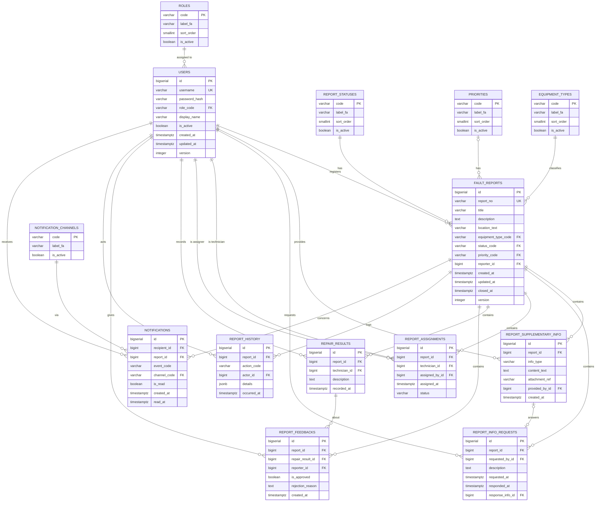

# مدل داده (Data Model) – سامانه مدیریت و گزارش خرابی دانشگاهی

**تهیه‌کننده:** رضا آدوسی  
**بازبین:** امیرحسن عارف اصل  
**آخرین به‌روزرسانی:** ۱۴۰۵/۰۸/۱۴

---

## مقدمه

این سند مدل دادهٔ منطقی سامانهٔ مدیریت و گزارش خرابی دانشگاهی را بر اساس مستندات تحلیل موجود ارائه می‌دهد. هدف، تعریف ساختار ذخیره‌سازی مفاهیم دامنه، کلیدها، محدودیت‌ها و روابط بین آن‌ها است؛ به‌گونه‌ای که پیاده‌سازی هر DBMS رابطه‌ای (PostgreSQL، MySQL، SQL Server و ...) از آن ممکن باشد.

منابع این سند:

- [`README.md`](../../README.md)
- [`user-story.md`](user-story.md)
- [`requirements-specification.md`](requirements-specification.md)
- [`activity.md`](activity.md)
- [`class-diagram.md`](class-diagram.md)
- [`CONTRIBUTING.md`](../../CONTRIBUTING.md)
- فایل‌های Feature: `US-01-report-fault.feature`، `US-05-verify-repair.feature`، `US-15-login.feature`

> **نکتهٔ مهم:** مدل داده با مدل دامنه یکی نیست. مدل داده به «چگونه ذخیره کنیم» پاسخ می‌دهد و مدل دامنه به «چه قواعدی در کسب‌وکار حاکم است». برخی ساده‌سازی‌های عمدی در این سند (مثل ادغام دانشجو و استاد در یک جدول) در بخش «تصمیم‌های مدل‌سازی» توضیح داده شده‌اند.

**قرارداد نام‌گذاری:** نام جدول‌ها و ستون‌ها به انگلیسی و `snake_case` است (استاندارد فنی پایگاه‌داده). برچسب‌های فارسی در جداول مرجع (`label_fa`) نگهداری می‌شوند تا تغییر متن فارسی نیازی به مهاجرت داده نداشته باشد. این تصمیم با بند «نام بازیگران: فقط نام فارسی» در [`CONTRIBUTING.md`](../../CONTRIBUTING.md) §۷ تعارضی ندارد، زیرا آن بند دربارهٔ **متن مستندات** است، نه نام‌گذاری فنی.

## ۱. تصمیم‌های مدل‌سازی

| # | تصمیم | گزینهٔ جایگزین | دلیل انتخاب | وابسته به |
|---|---|---|---|---|
| D1 | دانشجو و استاد در یک جدول `users` با ستون `role_code` | دو جدول جدا یا ارث‌بری جدولی | در همهٔ مستندات، دانشجو و استاد رفتار دادهٔ یکسانی دارند و فقط نقششان متفاوت است | — |
| D2 | `location_text` به‌صورت متن آزاد | جدول `locations` با ساختمان/طبقه/اتاق | `US-01.feature` محل را به‌صورت **یک فیلد متنی** با مقدار «ساختمان الف - کلاس ۱۰۲» تعریف کرده است | ابهام دامنه در `README.md` |
| D3 | وضعیت و اولویت و نوع تجهیز و نقش به‌صورت **جدول مرجع** | `ENUM` پایگاه‌داده یا `CHECK` | فهرست وضعیت‌ها و اولویت‌ها در پرسش‌های باز ۳ و ۴ تعریف‌نشده‌اند و باید بدون مهاجرت schema قابل تغییر باشند | پرسش باز ۳ و ۴ |
| D4 | یک گزارش می‌تواند **چند نتیجهٔ تعمیر** داشته باشد | یک نتیجهٔ واحد | `AD-06` مسیر بازگشت پس از رد را نشان می‌دهد؛ اگر این مسیر تأیید شود، چرخهٔ تعمیر تکرار می‌شود | پرسش باز ۷ |
| D5 | تأیید/رد به‌صورت جدول `report_feedbacks` با `UNIQUE (report_id, repair_result_id)` | فقط یک ردیف بازخورد per report | محدودیت یکتا، کلیک دوباره روی «تأیید» را در سطح داده بی‌اثر می‌کند (الزام `US-05.feature`) | — |
| D6 | حذف فیزیکی گزارش ممنوع؛ آرشیو = وضعیت `CLOSED` | ستون `deleted_at` | `NFR-05` از حذف ناخواسته منع می‌کند و بستن گزارش همان نقش آرشیو را دارد | نیاز به حذف منطقی: پرسش باز ۱۲ |
| D7 | `version` برای قفل خوش‌بینانه روی `fault_reports` و `users` | قفل بدبینانه | جلوگیری از بازنویسی هم‌زمان تغییرات (مرتبط با الزام idempotent در `US-05.feature`) | — |
| D8 | `report_no` جدا از `id` | استفاده از `id` به‌عنوان شناسه نمایشی | `US-05.feature` از قالب `R-100` استفاده می‌کند و `US-01.feature` «شناسه یکتا» را نمایش می‌دهد | فرمت تولید: پرسش باز ۱۱ |

## ۲. فهرست جدول‌ها

| # | جدول | نوع | توضیح | Aggregate |
|---|---|---|---|---|
| ۱ | `roles` | مرجع | نقش‌های کاربری | — |
| ۲ | `report_statuses` | مرجع | وضعیت‌های گزارش | — |
| ۳ | `priorities` | مرجع | سطوح اولویت | — |
| ۴ | `equipment_types` | مرجع | انواع تجهیز | — |
| ۵ | `notification_channels` | مرجع | کانال‌های اعلان | — |
| ۶ | `users` | اصلی | کاربران سامانه | کاربر |
| ۷ | `fault_reports` | اصلی | گزارش‌های خرابی | گزارش خرابی |
| ۸ | `report_supplementary_info` | اصلی | اطلاعات تکمیلی گزارش | گزارش خرابی |
| ۹ | `report_info_requests` | اصلی | درخواست‌های اطلاعات تکمیلی | گزارش خرابی |
| ۱۰ | `report_assignments` | اصلی | تخصیص تعمیرکار | گزارش خرابی |
| ۱۱ | `repair_results` | اصلی | نتایج تعمیر | گزارش خرابی |
| ۱۲ | `report_feedbacks` | اصلی | تأیید/رد گزارش‌دهنده | گزارش خرابی |
| ۱۳ | `report_history` | اصلی | تاریخچهٔ اقدامات (append-only) | گزارش خرابی |
| ۱۴ | `notifications` | اصلی | اعلان‌ها | اعلان |
| ۱۵ | `report_status_transitions` | اختیاری | انتقال‌های مجاز وضعیت | — |

> **داشبورد** جدول ندارد؛ یک `VIEW` یا کوئری تجمیعی روی `fault_reports` است (طبق `class-diagram.md` که آن را `Read Model` علامت زده است).

## ۳. نمودار ERD

> نمودار به‌صورت انگلیسی نوشته شده تا در همهٔ رندررها (از جمله GitHub) درست نمایش داده شود. توضیحات فارسی در بخش‌های ۴ و ۵ آمده است.



## ۴. جداول مرجع (Lookup)

همهٔ جداول مرجع ساختار یکسانی دارند: `code` (کلید پایدار انگلیسی)، `label_fa` (برچسب فارسی)، `sort_order` و `is_active`. تغییر متن فارسی بدون مهاجرت schema ممکن است و افزودن مقدار جدید نیاز به تغییر کد ندارد.

### ۴.۱. `roles` — نقش‌ها

| code | label_fa | sort_order | مرجع |
|---|---|---|---|
| `STUDENT` | دانشجو | ۱۰ | requirements §۲ |
| `PROFESSOR` | استاد | ۲۰ | requirements §۲ |
| `FACILITIES_STAFF` | کارمند تأسیسات | ۳۰ | requirements §۲ |
| `TECHNICIAN` | تعمیرکار | ۴۰ | requirements §۲ |
| `MANAGER` | مدیر | ۵۰ | requirements §۲ |

> **نکته:** «کاربر سیستم» در `AD-01` و `US-15` یک **نقش** نیست، بلکه عنوان عمومی هر کاربر احراز هویت‌شده است (طبق `activity.md` §۱). بنابراین در این جدول مقدار ندارد.

### ۴.۲. `report_statuses` — وضعیت‌های گزارش

| code | label_fa | sort_order | مستند مرجع |
|---|---|---|---|
| `SUBMITTED` | ثبت‌شده | ۱۰ | `US-01.feature`، `US-05.feature` |
| `ASSIGNED` | ارجاع‌شده | ۲۰ | `US-05.feature` |
| `IN_REPAIR` | در حال تعمیر | ۳۰ | `US-05.feature`، `US-12` |
| `REPAIRED` | تعمیر انجام‌شده | ۴۰ | `US-05.feature` |
| `CLOSED` | بسته‌شده | ۵۰ | `US-05.feature` |

> ⚠️ **پرسش باز ۴:** این فهرست از مثال‌های `US-05.feature` استخراج شده و **رسمی نیست**. «باز» (در `FR-17` و `US-06`) یک وضعیت نیست؛ به‌معنای «هر گزارشی که `status_code <> 'CLOSED'` است» می‌باشد و نباید ردیفی در این جدول داشته باشد. «نیازمند پیگیری» نیز فعلاً برچسب است، نه وضعیت (پرسش باز ۷).

### ۴.۳. `priorities` — سطوح اولویت

| code | label_fa | sort_order | مستند مرجع |
|---|---|---|---|
| `LOW` | کم | ۱۰ | **فرض موقت** |
| `MEDIUM` | متوسط | ۲۰ | **فرض موقت** |
| `HIGH` | زیاد | ۳۰ | **فرض موقت** |
| `URGENT` | فوری | ۴۰ | `US-17` (واژهٔ «فوری» آمده) |

> ⚠️ **پرسش باز ۳:** سطوح رسمی و معیار هر سطح در نیازمندی‌ها تعیین نشده است. سه سطح اول **فرض موقت** هستند و باید پیش از پیاده‌سازی تأیید شوند.

### ۴.۴. `equipment_types` — انواع تجهیز

| code | label_fa | مستند مرجع |
|---|---|---|
| `LIGHTING` | روشنایی | `US-01.feature` |
| `HVAC` | تهویه | `README.md` |
| `ELEVATOR` | آسانسور | `README.md` |
| `ELECTRICAL` | برق | `README.md` |
| `PROJECTOR` | پروژکتور | `README.md` |
| `OTHER` | سایر | پیشنهادی (پوشش موارد دیگر) |

### ۴.۵. `notification_channels` — کانال‌های اعلان

| code | label_fa | وضعیت |
|---|---|---|
| `IN_APP` | داخل سامانه | **تأییدنشده** |
| `SMS` | پیامک | **تأییدنشده** |
| `EMAIL` | ایمیل | **تأییدنشده** |

> ⚠️ **پرسش باز ۸:** هیچ کانالی در نیازمندی‌ها تأیید نشده است. این سه مقدار فقط به‌عنوان **دادهٔ نمونه** درج شده‌اند و باید پس از تصمیم‌گیری تیم نهایی شوند.

## ۵. جداول اصلی (Entities)

### ۵.۱. `users` — کاربران سامانه

| ستون | نوع | Null | پیش‌فرض | محدودیت | توضیح | مرجع |
|---|---|---|---|---|---|---|
| `id` | `bigserial` | خیر | — | PK | شناسه فنی | — |
| `username` | `varchar(50)` | خیر | — | UNIQUE، `CHECK (btrim(username) <> '')` | نام کاربری | `FR-01`، `US-15.feature` |
| `password_hash` | `varchar(255)` | خیر | — | — | هش رمز (هرگز رمز خام) | `FR-01`، `NFR-01` |
| `role_code` | `varchar(30)` | خیر | — | FK → `roles.code` | نقش کاربر | `FR-02` |
| `display_name` | `varchar(100)` | بله | NULL | — | نام نمایشی (در مستندات الزامی نشده) | — |
| `is_active` | `boolean` | خیر | `true` | — | فعال/غیرفعال | — |
| `created_at` | `timestamptz` | خیر | `now()` | — | زمان ایجاد | — |
| `updated_at` | `timestamptz` | خیر | `now()` | — | آخرین تغییر | — |
| `version` | `integer` | خیر | `1` | — | قفل خوش‌بینانه | — |

**نکته:** `US-15.feature` الزام می‌کند پیام خطای ورود مشخص نکند کدام فیلد اشتباه است. این یک قاعدهٔ **لایهٔ اپلیکیشن** است، نه محدودیت داده.

> ⚠️ **پرسش باز ۹ (مهم):** اگر تصمیم تیم این باشد که یک کاربر می‌تواند **چند نقش** داشته باشد، باید ستون `role_code` حذف و جدول `user_roles (user_id, role_code)` اضافه شود. مدل فعلی بر پایهٔ **یک نقش per کاربر** است و با `class-diagram.md` (که ارث‌بری دارد) هم‌خوان است، ولی با `domain-model.md` (که نقش را Value Object چندمقداری دیده) هم‌خوان نیست. **پس از پاسخ به پرسش باز ۹، هر سه سند باید هم‌زمان به‌روزرسانی شوند.**

### ۵.۲. `fault_reports` — گزارش‌های خرابی

| ستون | نوع | Null | پیش‌فرض | محدودیت | توضیح | مرجع |
|---|---|---|---|---|---|---|
| `id` | `bigserial` | خیر | — | PK | شناسه فنی | — |
| `report_no` | `varchar(20)` | خیر | — | UNIQUE | شناسهٔ نمایشی (مثل `R-100`) | `US-05.feature` |
| `title` | `varchar(150)` | خیر | — | `CHECK (char_length(title) BETWEEN 1 AND 150)` | عنوان | `US-01.feature`، `FR-03` |
| `description` | `text` | خیر | — | `CHECK (btrim(description) <> '')` | توضیحات | `US-01.feature`، `FR-03` |
| `location_text` | `varchar(255)` | خیر | — | `CHECK (btrim(location_text) <> '')` | محل خرابی (متن آزاد) | `US-01.feature`، `FR-03` |
| `equipment_type_code` | `varchar(30)` | خیر | — | FK → `equipment_types.code` | نوع تجهیز | `US-01.feature`، `FR-03` |
| `status_code` | `varchar(30)` | خیر | `'SUBMITTED'` | FK → `report_statuses.code` | وضعیت جاری | `US-01.feature` |
| `priority_code` | `varchar(30)` | بله | NULL | FK → `priorities.code` | اولویت (تا زمان تعیین خالی است) | `FR-07`، `US-07` |
| `reporter_id` | `bigint` | خیر | — | FK → `users.id` | گزارش‌دهنده | `FR-03`، `US-01`، `US-02` |
| `created_at` | `timestamptz` | خیر | `now()` | — | زمان ثبت | — |
| `updated_at` | `timestamptz` | خیر | `now()` | — | آخرین تغییر | — |
| `closed_at` | `timestamptz` | بله | NULL | — | زمان بستن گزارش | `US-05.feature` |
| `version` | `integer` | خیر | `1` | — | قفل خوش‌بینانه | `US-05.feature` (idempotency) |

**محدودیت ترکیبی:** `UNIQUE (id, reporter_id)` — برای اینکه جدول بازخورد بتواند تضمین کند فقط گزارش‌دهندهٔ همان گزارش تأیید می‌کند (بخش ۶).

> **نکتهٔ D2:** `location_text` عمداً متن آزاد است چون `US-01.feature` محل را به‌صورت یک فیلد متنی تعریف کرده است. اگر دامنهٔ سامانه گسترش یابد (ابهام `README.md` دربارهٔ خوابگاه و فضاهای اداری)، در آینده می‌توان `location_text` را نگه داشت و جدول ساختاریافتهٔ `locations` را به‌عنوان مکمل اضافه کرد. `class-diagram.md` فعلاً نسخهٔ ساختاریافته را نشان می‌دهد و این تفاوت باید در بازبینی هم‌راستا شود.

> **نکتهٔ D6:** حذف فیزیکی ردیف مجاز نیست (`NFR-05`). بستن گزارش با `status_code = 'CLOSED'` و مقدارگرفتن `closed_at` انجام می‌شود.

### ۵.۳. `report_supplementary_info` — اطلاعات تکمیلی

| ستون | نوع | Null | پیش‌فرض | محدودیت | توضیح | مرجع |
|---|---|---|---|---|---|---|
| `id` | `bigserial` | خیر | — | PK | — | — |
| `report_id` | `bigint` | خیر | — | FK → `fault_reports.id` | گزارش مرتبط | `FR-04`، `US-04` |
| `info_type` | `varchar(20)` | خیر | — | `CHECK (info_type IN ('TEXT','IMAGE'))` | نوع محتوا | `FR-04` |
| `content_text` | `text` | بله | NULL | `CHECK (info_type <> 'TEXT' OR content_text IS NOT NULL)` | متن توضیح | `FR-04` |
| `attachment_ref` | `varchar(500)` | بله | NULL | `CHECK (info_type <> 'IMAGE' OR attachment_ref IS NOT NULL)` | مسیر/شناسهٔ فایل تصویر | `FR-04` |
| `provided_by_id` | `bigint` | خیر | — | FK → `users.id` | ارائه‌دهنده | `US-04` |
| `created_at` | `timestamptz` | خیر | `now()` | — | زمان ارائه | — |

> **پرسش باز ۶:** `US-04` فقط گزارش‌دهنده را ارائه‌دهنده می‌داند، اما `AD-04` نشان می‌دهد تعمیرکار نیز می‌تواند درخواست اطلاعات دهد. اینکه چه کسی **مجاز به ارائه** است در مستندات صریح نیست؛ مدل فعلی هر کاربری را می‌پذیرد و کنترل آن به لایهٔ اپلیکیشن واگذار شده است.

### ۵.۴. `report_info_requests` — درخواست اطلاعات تکمیلی

| ستون | نوع | Null | پیش‌فرض | محدودیت | توضیح | مرجع |
|---|---|---|---|---|---|---|
| `id` | `bigserial` | خیر | — | PK | — | — |
| `report_id` | `bigint` | خیر | — | FK → `fault_reports.id` | گزارش مرتبط | `FR-13`، `US-14` |
| `requested_by_id` | `bigint` | خیر | — | FK → `users.id` | درخواست‌دهنده | `US-14`، `AD-04` |
| `description` | `text` | خیر | — | `CHECK (btrim(description) <> '')` | متن درخواست | `US-14` |
| `requested_at` | `timestamptz` | خیر | `now()` | — | زمان درخواست | — |
| `responded_at` | `timestamptz` | بله | NULL | — | زمان پاسخ | `AD-04` |
| `response_info_id` | `bigint` | بله | NULL | FK → `report_supplementary_info.id`، UNIQUE | پاسخ مرتبط | `AD-04` |

> **پرسش باز ۶:** اینکه چه کسانی مجاز به **درخواست** هستند (فقط تعمیرکار یا کارمند تأسیسات هم) در مستندات مشخص نیست. ستون `requested_by_id` به `users` ارجاع می‌دهد و نقش در `report_history` ثبت می‌شود.

### ۵.۵. `report_assignments` — تخصیص تعمیرکار (مأموریت)

| ستون | نوع | Null | پیش‌فرض | محدودیت | توضیح | مرجع |
|---|---|---|---|---|---|---|
| `id` | `bigserial` | خیر | — | PK | — | — |
| `report_id` | `bigint` | خیر | — | FK → `fault_reports.id` | گزارش | `FR-09`، `US-08` |
| `technician_id` | `bigint` | خیر | — | FK → `users.id` | تعمیرکار | `US-08`، `US-11` |
| `assigned_by_id` | `bigint` | خیر | — | FK → `users.id` | تخصیص‌دهنده (کارمند تأسیسات) | `AD-03` |
| `assigned_at` | `timestamptz` | خیر | `now()` | — | زمان تخصیص | — |
| `status` | `varchar(20)` | خیر | `'ASSIGNED'` | `CHECK (status IN ('ASSIGNED','STARTED','DONE','CANCELLED'))` | وضعیت تخصیص | `US-12`، `US-13` |

> ⚠️ **پرسش باز ۵:** آیا یک گزارش می‌تواند هم‌زمان چند تخصیص فعال داشته باشد؟ مدل فعلی این را **مجاز** می‌داند (چند ردیف per report). اگر تصمیم نهایی «یک تعمیرکار در هر لحظه» باشد، باید یک **ایندکس یگانهٔ جزئی** اضافه شود:
> `CREATE UNIQUE INDEX ... ON report_assignments (report_id) WHERE status IN ('ASSIGNED','STARTED');`

### ۵.۶. `repair_results` — نتایج تعمیر

| ستون | نوع | Null | پیش‌فرض | محدودیت | توضیح | مرجع |
|---|---|---|---|---|---|---|
| `id` | `bigserial` | خیر | — | PK | — | — |
| `report_id` | `bigint` | خیر | — | FK → `fault_reports.id` | گزارش | `FR-12`، `US-13` |
| `technician_id` | `bigint` | خیر | — | FK → `users.id` | ثبت‌کننده | `US-13` |
| `description` | `text` | خیر | — | `CHECK (btrim(description) <> '')` | توضیحات اقدامات | `FR-12` |
| `recorded_at` | `timestamptz` | خیر | `now()` | — | زمان ثبت | — |

> **نکتهٔ D4:** چند نتیجه per گزارش مجاز است تا اگر مسیر «بازگشت پس از رد» (`AD-06`) تأیید شد، چرخهٔ تعمیر تکرارشدنی باشد (پرسش باز ۷).

### ۵.۷. `report_feedbacks` — بازخورد گزارش‌دهنده (تأیید/رد)

| ستون | نوع | Null | پیش‌فرض | محدودیت | توضیح | مرجع |
|---|---|---|---|---|---|---|
| `id` | `bigserial` | خیر | — | PK | — | — |
| `report_id` | `bigint` | خیر | — | FK (ترکیبی) | گزارش | `FR-14`، `US-05` |
| `repair_result_id` | `bigint` | خیر | — | FK → `repair_results.id` | نتیجهٔ تعمیر مورد بررسی | `US-05.feature` |
| `reporter_id` | `bigint` | خیر | — | FK (ترکیبی) | تأییدکننده | `US-05.feature` |
| `is_approved` | `boolean` | خیر | — | — | تأیید (`true`) یا رد (`false`) | `US-05.feature` |
| `rejection_reason` | `text` | بله | NULL | `CHECK` (بخش ۶) | دلیل رد | `US-05.feature` |
| `created_at` | `timestamptz` | خیر | `now()` | — | زمان ثبت | — |

**محدودیت‌های کلیدی:**

- `UNIQUE (report_id, repair_result_id)` → مانع ثبت دو بازخورد برای یک نتیجهٔ تعمیر؛ همین، کلیک دوباره روی «تأیید» را در سطح داده بی‌اثر می‌کند (`US-05.feature`).
- `FOREIGN KEY (report_id, reporter_id) REFERENCES fault_reports (id, reporter_id)` → **در سطح داده** تضمین می‌کند فقط گزارش‌دهندهٔ همان گزارش می‌تواند بازخورد بدهد (`US-05.feature`).
- `CHECK (is_approved OR (rejection_reason IS NOT NULL AND btrim(rejection_reason) <> ''))` → دلیل رد اجباری (`US-05.feature`).
- `CHECK (NOT is_approved OR rejection_reason IS NULL)` → در حالت تأیید، دلیل رد نباید مقدار داشته باشد.

> **محدودیتی که در داده قابل اعمال نیست:** «تأیید فقط در وضعیت `REPAIRED` مجاز است» یک قاعدهٔ **بین‌جدولی** است و باید در لایهٔ اپلیکیشن (داخل یک تراکنش با قفل ردیف گزارش) یا با تریگر پیاده شود. در بخش ۶ توضیح داده شده است.

### ۵.۸. `report_history` — تاریخچهٔ اقدامات

| ستون | نوع | Null | پیش‌فرض | محدودیت | توضیح | مرجع |
|---|---|---|---|---|---|---|
| `id` | `bigserial` | خیر | — | PK | — | — |
| `report_id` | `bigint` | خیر | — | FK → `fault_reports.id` | گزارش | `FR-16`، `US-10` |
| `action_code` | `varchar(40)` | خیر | — | `CHECK` (بخش ۶) | نوع اقدام | `FR-16`، `US-05.feature` |
| `actor_id` | `bigint` | بله | NULL | FK → `users.id` | انجام‌دهنده (NULL برای اقدام سیستمی) | `FR-16` |
| `details` | `jsonb` | بله | NULL | — | جزئیات (مثلاً دلیل رد) | `US-05.feature` |
| `occurred_at` | `timestamptz` | خیر | `now()` | — | زمان وقوع | `US-10` |

**مقادیر مجاز `action_code`:** `REPORT_SUBMITTED`، `SUPPLEMENTARY_INFO_ADDED`، `INFO_REQUESTED`، `INFO_PROVIDED`، `PRIORITY_ASSIGNED`، `TECHNICIAN_ASSIGNED`، `REPAIR_STARTED`، `REPAIR_RESULT_RECORDED`، `REPAIR_APPROVED`، `REPAIR_REJECTED`، `REPORT_CLOSED`.

> **نکته:** این جدول **append-only** است. `UPDATE` و `DELETE` روی آن مجاز نیست و باید با مجوزهای پایگاه‌داده یا تریگر مسدود شود (`NFR-05`).

### ۵.۹. `notifications` — اعلان‌ها

| ستون | نوع | Null | پیش‌فرض | محدودیت | توضیح | مرجع |
|---|---|---|---|---|---|---|
| `id` | `bigserial` | خیر | — | PK | — | — |
| `recipient_id` | `bigint` | خیر | — | FK → `users.id` | گیرنده | `FR-15`، `US-16` |
| `report_id` | `bigint` | بله | NULL | FK → `fault_reports.id` | گزارش مرتبط | `US-16` |
| `event_code` | `varchar(40)` | خیر | — | `CHECK` | رویداد مبدأ | `FR-15` |
| `channel_code` | `varchar(20)` | خیر | — | FK → `notification_channels.code` | کانال ارسال | **پرسش باز ۸** |
| `is_read` | `boolean` | خیر | `false` | — | خوانده‌شده | — |
| `created_at` | `timestamptz` | خیر | `now()` | — | زمان ایجاد | — |
| `read_at` | `timestamptz` | بله | NULL | `CHECK ((is_read) = (read_at IS NOT NULL))` | زمان خواندن | — |

> **مقادیر مجاز `event_code`:** همان مقادیر `action_code` در `report_history` (بخش ۵.۸) به‌اضافهٔ `LOGIN_FAILED` در صورت نیاز.

## ۶. کلیدها و محدودیت‌ها — خلاصه

### ۶.۱. کلیدهای اصلی و یکتا

| جدول | PK | UK |
|---|---|---|
| `roles` | `code` | — |
| `report_statuses` | `code` | — |
| `priorities` | `code` | — |
| `equipment_types` | `code` | — |
| `notification_channels` | `code` | — |
| `users` | `id` | `username` |
| `fault_reports` | `id` | `report_no`، `(id, reporter_id)` |
| `report_supplementary_info` | `id` | — |
| `report_info_requests` | `id` | `response_info_id` |
| `report_assignments` | `id` | — |
| `repair_results` | `id` | — |
| `report_feedbacks` | `id` | `(report_id, repair_result_id)` |
| `report_history` | `id` | — |
| `notifications` | `id` | — |

### ۶.۲. محدودیت‌های `CHECK` تأییدشده

| قاعده | جدول | مستند مرجع |
|---|---|---|
| عنوان بین ۱ و ۱۵۰ کاراکتر | `fault_reports` | `US-01.feature` |
| عنوان، توضیحات، محل، نوع تجهیز خالی نباشند | `fault_reports` | `US-01.feature` |
| وضعیت اولیه `SUBMITTED` | `fault_reports` (DEFAULT) | `US-01.feature` |
| دلیل رد هنگام رد اجباری باشد | `report_feedbacks` | `US-05.feature` |
| دلیل رد هنگام تأیید خالی باشد | `report_feedbacks` | `US-05.feature` |
| تأییدکننده همان گزارش‌دهنده باشد | `report_feedbacks` (FK ترکیبی) | `US-05.feature` |
| یک بازخورد per نتیجهٔ تعمیر | `report_feedbacks` (UNIQUE) | `US-05.feature` |
| `read_at` با `is_read` هم‌خوان باشد | `notifications` | — |

### ۶.۳. قواعدی که در داده قابل اعمال نیستند (لایهٔ اپلیکیشن یا تریگر)

| قاعده | دلیل | مستند مرجع |
|---|---|---|
| تأیید فقط در وضعیت `REPAIRED` | قاعدهٔ بین‌جدولی | `US-05.feature` |
| تغییر وضعیت فقط از طریق انتقال‌های مجاز | وابسته به پرسش باز ۴ | `activity.md` |
| `closed_at` هنگام `CLOSED` پر باشد | قاعدهٔ بین‌ستونیِ وابسته به جدول مرجع | `US-05.feature` |
| دسترسی مبتنی بر نقش | قاعدهٔ لایهٔ اپلیکیشن | `FR-02`، `US-15.feature` |
| پیام خطای ورود مبهم باشد | قاعدهٔ لایهٔ اپلیکیشن | `US-15.feature` |

## ۷. ایندکس‌ها

| جدول | ایندکس | نوع | دلیل |
|---|---|---|---|
| `users` | `(username)` | UNIQUE | ورود سریع، `US-15` |
| `fault_reports` | `(report_no)` | UNIQUE | جست‌وجو با شناسهٔ نمایشی |
| `fault_reports` | `(reporter_id, created_at DESC)` | عادی | «گزارش‌های من»، `FR-05`، `US-03` |
| `fault_reports` | `(status_code, priority_code, created_at DESC)` | عادی | فهرست و فیلتر گزارش‌های باز، `FR-08`، `US-06` |
| `fault_reports` | `(report_id)` روی `(status_code)` WHERE `status_code <> 'CLOSED'` | جزئی | کوئری «گزارش‌های باز» و داشبورد، `FR-17` |
| `report_assignments` | `(technician_id, status)` | عادی | «مأموریت‌های من»، `FR-10`، `US-11` |
| `report_assignments` | `(report_id)` WHERE `status IN ('ASSIGNED','STARTED')` | جزئی (اختیاری) | فقط اگر پاسخ پرسش باز ۵ «یک تعمیرکار هم‌زمان» باشد |
| `report_feedbacks` | `(report_id, repair_result_id)` | UNIQUE | ایدمپوتنسی تأیید، `US-05.feature` |
| `report_history` | `(report_id, occurred_at DESC)` | عادی | نمایش تاریخچه، `FR-16`، `US-10` |
| `notifications` | `(recipient_id, is_read, created_at DESC)` | عادی | فهرست اعلان‌های خوانده‌نشده |
| `report_supplementary_info` | `(report_id, created_at)` | عادی | نمایش اطلاعات تکمیلی |

## ۸. ماشین حالت در داده

جدول `report_status_transitions` (اختیاری) ماشین حالت را از کد به **داده** منتقل می‌کند و مستقیماً به پرسش باز ۴ پاسخ می‌دهد:

| from_status_code | to_status_code | action_code | وضعیت |
|---|---|---|---|
| `SUBMITTED` | `ASSIGNED` | `TECHNICIAN_ASSIGNED` | ✅ تأییدشده (`AD-03`، `FR-09`) |
| `ASSIGNED` | `IN_REPAIR` | `REPAIR_STARTED` | ✅ تأییدشده (`AD-04`، `US-12`) |
| `IN_REPAIR` | `REPAIRED` | `REPAIR_RESULT_RECORDED` | ✅ تأییدشده (`AD-04`، `US-13`) |
| `REPAIRED` | `CLOSED` | `REPAIR_APPROVED` | ✅ تأییدشده (`AD-05`، `US-05.feature`) |
| `REPAIRED` | ؟ | `REPAIR_REJECTED` | ❓ **پرسش باز ۷** |
| `IN_REPAIR` | ؟ (انتظار اطلاعات) | `INFO_REQUESTED` | ❓ **پرسش باز ۶** |

مزیت: انتقال‌های تأییدشده همین حالا قابل seed هستند و انتقال‌های نامشخص بعداً **فقط با درج ردیف** اضافه می‌شوند، بدون تغییر کد.

## ۹. یادداشت‌های نرمال‌سازی و نگهداشت

- **فرم نرمال سوم (3NF):** همهٔ جداول در 3NF هستند؛ نام‌های تکراری (وضعیت، اولویت، نوع تجهیز، نقش، کانال) به جداول مرجع منتقل شده‌اند.
- **عدم تکرار داده:** وضعیت جاری **فقط** در `fault_reports.status_code` نگهداری می‌شود و در `report_history` به‌عنوان رویداد ثبت می‌شود؛ وضعیت در دو جا ذخیره نمی‌شود.
- **`report_history` به‌عنوان audit trail:** این جدول عمداً denormalize نشده و جزئیات در `jsonb` نگهداری می‌شود تا افزودن فیلدهای آینده بدون مهاجرت ممکن باشد.
- **نگهداشت (`NFR-05`):** حذف فیزیکی گزارش و تاریخچه ممنوع است. سیاست دقیق نگهداشت و آرشیو باید تعیین شود (پرسش باز ۱۲).
- **قفل خوش‌بینانه:** `version` روی `fault_reports` و `users` برای جلوگیری از بازنویسی هم‌زمان. هنگام `UPDATE` باید `WHERE version = ?` اعمال و `version = version + 1` شود.
- **منطقهٔ زمانی:** همهٔ زمان‌ها `timestamptz` (با منطقهٔ زمانی) هستند، نه `timestamp` ساده.

## ۱۰. ردیابی به مستندات

| عنصر داده | مستند مرجع |
|---|---|
| `users`، `roles` | `FR-01`، `FR-02`، `US-15`، `AD-01` |
| `fault_reports` | `FR-03` تا `FR-05`، `FR-11`، `FR-14` تا `FR-16`، `US-01` تا `US-05`، `US-09`، `US-10`، `AD-02` تا `AD-06` |
| `report_supplementary_info` | `FR-04`، `US-04`، `AD-02`، `AD-04` |
| `report_info_requests` | `FR-13`، `US-14`، `AD-04` |
| `report_assignments` | `FR-09`، `US-08`، `US-11`، `AD-03`، `AD-04` |
| `repair_results` | `FR-12`، `US-13`، `AD-04` |
| `report_feedbacks` | `FR-14`، `US-05`، `AD-05`، `US-05.feature` |
| `report_history` | `FR-16`، `US-03`، `US-05`، `US-10`، `AD-03` |
| `notifications` | `FR-15`، `US-16`، `AD-04` |
| `report_statuses` | `US-01.feature`، `US-05.feature`، `US-12`، `AD-03` تا `AD-05` |
| `priorities` | `FR-07`، `US-07`، `AD-03` (سطوح: پرسش باز ۳) |
| `equipment_types` | `FR-03`، `US-01.feature`، `README.md` |
| محدودیت ۱۵۰ کاراکتر و فیلدهای اجباری | `US-01.feature` |
| محدودیت‌های تأیید/رد | `US-05.feature` |
| یکتایی نام کاربری و هش رمز | `FR-01`، `US-15.feature`، `NFR-01` |

## ۱۱. پیوست — DDL مرجع (PostgreSQL)

> ⚠️ این پیوست **غیرالزام‌آور** است و فقط برای نشان‌دادن نگاشت مدل منطقی به یک پیاده‌سازی مشخص آورده شده. اگر تیم DBMS دیگری انتخاب کند (مثلاً MySQL)، این DDL باید معادل‌سازی شود و بخش‌های `jsonb`، `bigserial`، `timestamptz` و ایندکس‌های جزئی نیاز به تطبیق دارند.

```sql
-- =========================================================
-- مرجع DDL – PostgreSQL
-- =========================================================

-- ۱) جداول مرجع
CREATE TABLE roles (
    code       varchar(30) PRIMARY KEY,
    label_fa   varchar(60) NOT NULL,
    sort_order smallint NOT NULL DEFAULT 0,
    is_active  boolean NOT NULL DEFAULT true
);

CREATE TABLE report_statuses (
    code       varchar(30) PRIMARY KEY,
    label_fa   varchar(60) NOT NULL,
    sort_order smallint NOT NULL DEFAULT 0,
    is_active  boolean NOT NULL DEFAULT true
);

CREATE TABLE priorities (
    code       varchar(30) PRIMARY KEY,
    label_fa   varchar(60) NOT NULL,
    sort_order smallint NOT NULL DEFAULT 0,
    is_active  boolean NOT NULL DEFAULT true
);

CREATE TABLE equipment_types (
    code       varchar(30) PRIMARY KEY,
    label_fa   varchar(60) NOT NULL,
    sort_order smallint NOT NULL DEFAULT 0,
    is_active  boolean NOT NULL DEFAULT true
);

CREATE TABLE notification_channels (
    code      varchar(20) PRIMARY KEY,
    label_fa  varchar(60) NOT NULL,
    is_active boolean NOT NULL DEFAULT true
);

-- ۲) دادهٔ اولیهٔ جداول مرجع
INSERT INTO roles (code, label_fa, sort_order) VALUES
    ('STUDENT',          'دانشجو',          10),
    ('PROFESSOR',        'استاد',           20),
    ('FACILITIES_STAFF', 'کارمند تأسیسات',  30),
    ('TECHNICIAN',       'تعمیرکار',        40),
    ('MANAGER',          'مدیر',            50);

INSERT INTO report_statuses (code, label_fa, sort_order) VALUES
    ('SUBMITTED', 'ثبت‌شده',          10),
    ('ASSIGNED',  'ارجاع‌شده',        20),
    ('IN_REPAIR', 'در حال تعمیر',     30),
    ('REPAIRED',  'تعمیر انجام‌شده',  40),
    ('CLOSED',    'بسته‌شده',         50);

-- سطوح اولویت موقت هستند (پرسش باز ۳)
INSERT INTO priorities (code, label_fa, sort_order) VALUES
    ('LOW',    'کم',    10),
    ('MEDIUM', 'متوسط', 20),
    ('HIGH',   'زیاد',  30),
    ('URGENT', 'فوری',  40);

INSERT INTO equipment_types (code, label_fa, sort_order) VALUES
    ('LIGHTING',   'روشنایی',  10),
    ('HVAC',       'تهویه',    20),
    ('ELEVATOR',   'آسانسور',  30),
    ('ELECTRICAL', 'برق',      40),
    ('PROJECTOR',  'پروژکتور', 50),
    ('OTHER',      'سایر',     60);

-- کانال‌ها تأییدنشده‌اند (پرسش باز ۸)
INSERT INTO notification_channels (code, label_fa) VALUES
    ('IN_APP', 'داخل سامانه'),
    ('SMS',    'پیامک'),
    ('EMAIL',  'ایمیل');

-- ۳) کاربران
CREATE TABLE users (
    id            bigserial PRIMARY KEY,
    username      varchar(50)  NOT NULL,
    password_hash varchar(255) NOT NULL,
    role_code     varchar(30)  NOT NULL REFERENCES roles(code),
    display_name  varchar(100),
    is_active     boolean      NOT NULL DEFAULT true,
    created_at    timestamptz  NOT NULL DEFAULT now(),
    updated_at    timestamptz  NOT NULL DEFAULT now(),
    version       integer      NOT NULL DEFAULT 1,
    CONSTRAINT uq_users_username UNIQUE (username),
    CONSTRAINT ck_users_username_not_blank CHECK (btrim(username) <> '')
);

-- ۴) گزارش خرابی
CREATE TABLE fault_reports (
    id                   bigserial PRIMARY KEY,
    report_no            varchar(20)  NOT NULL,
    title                varchar(150) NOT NULL,
    description          text         NOT NULL,
    location_text        varchar(255) NOT NULL,
    equipment_type_code  varchar(30)  NOT NULL REFERENCES equipment_types(code),
    status_code          varchar(30)  NOT NULL DEFAULT 'SUBMITTED'
                                       REFERENCES report_statuses(code),
    priority_code        varchar(30)  REFERENCES priorities(code),
    reporter_id          bigint       NOT NULL REFERENCES users(id),
    created_at           timestamptz  NOT NULL DEFAULT now(),
    updated_at           timestamptz  NOT NULL DEFAULT now(),
    closed_at            timestamptz,
    version              integer      NOT NULL DEFAULT 1,
    CONSTRAINT uq_fault_reports_no UNIQUE (report_no),
    CONSTRAINT uq_fault_reports_id_reporter UNIQUE (id, reporter_id),
    CONSTRAINT ck_fault_reports_title CHECK (char_length(title) BETWEEN 1 AND 150),
    CONSTRAINT ck_fault_reports_description CHECK (btrim(description) <> ''),
    CONSTRAINT ck_fault_reports_location CHECK (btrim(location_text) <> '')
);

-- ۵) اطلاعات تکمیلی
CREATE TABLE report_supplementary_info (
    id              bigserial PRIMARY KEY,
    report_id       bigint       NOT NULL REFERENCES fault_reports(id),
    info_type       varchar(20)  NOT NULL,
    content_text    text,
    attachment_ref  varchar(500),
    provided_by_id  bigint       NOT NULL REFERENCES users(id),
    created_at      timestamptz  NOT NULL DEFAULT now(),
    CONSTRAINT ck_supp_info_type CHECK (info_type IN ('TEXT','IMAGE')),
    CONSTRAINT ck_supp_info_content CHECK (
        (info_type = 'TEXT'  AND content_text   IS NOT NULL) OR
        (info_type = 'IMAGE' AND attachment_ref IS NOT NULL)
    )
);

-- ۶) درخواست اطلاعات
CREATE TABLE report_info_requests (
    id                bigserial PRIMARY KEY,
    report_id         bigint       NOT NULL REFERENCES fault_reports(id),
    requested_by_id   bigint       NOT NULL REFERENCES users(id),
    description       text         NOT NULL,
    requested_at      timestamptz  NOT NULL DEFAULT now(),
    responded_at      timestamptz,
    response_info_id  bigint       UNIQUE REFERENCES report_supplementary_info(id),
    CONSTRAINT ck_info_request_description CHECK (btrim(description) <> '')
);

-- ۷) تخصیص تعمیرکار
CREATE TABLE report_assignments (
    id             bigserial PRIMARY KEY,
    report_id      bigint       NOT NULL REFERENCES fault_reports(id),
    technician_id  bigint       NOT NULL REFERENCES users(id),
    assigned_by_id bigint       NOT NULL REFERENCES users(id),
    assigned_at    timestamptz  NOT NULL DEFAULT now(),
    status         varchar(20)  NOT NULL DEFAULT 'ASSIGNED',
    CONSTRAINT ck_assignment_status
        CHECK (status IN ('ASSIGNED','STARTED','DONE','CANCELLED'))
);

-- ۸) نتیجهٔ تعمیر
CREATE TABLE repair_results (
    id             bigserial PRIMARY KEY,
    report_id      bigint       NOT NULL REFERENCES fault_reports(id),
    technician_id  bigint       NOT NULL REFERENCES users(id),
    description    text         NOT NULL,
    recorded_at    timestamptz  NOT NULL DEFAULT now(),
    CONSTRAINT ck_repair_result_description CHECK (btrim(description) <> '')
);

-- ۹) بازخورد گزارش‌دهنده
CREATE TABLE report_feedbacks (
    id                bigserial PRIMARY KEY,
    report_id         bigint       NOT NULL,
    repair_result_id  bigint       NOT NULL REFERENCES repair_results(id),
    reporter_id       bigint       NOT NULL,
    is_approved       boolean      NOT NULL,
    rejection_reason  text,
    created_at        timestamptz  NOT NULL DEFAULT now(),
    CONSTRAINT uq_feedback_per_result UNIQUE (report_id, repair_result_id),
    CONSTRAINT fk_feedback_reporter
        FOREIGN KEY (report_id, reporter_id)
        REFERENCES fault_reports (id, reporter_id),
    CONSTRAINT ck_feedback_rejection_reason_required
        CHECK (is_approved OR (rejection_reason IS NOT NULL
                               AND btrim(rejection_reason) <> '')),
    CONSTRAINT ck_feedback_rejection_reason_absent
        CHECK (NOT is_approved OR rejection_reason IS NULL)
);

-- ۱۰) تاریخچه (append-only)
CREATE TABLE report_history (
    id           bigserial PRIMARY KEY,
    report_id    bigint       NOT NULL REFERENCES fault_reports(id),
    action_code  varchar(40)  NOT NULL,
    actor_id     bigint       REFERENCES users(id),
    details      jsonb,
    occurred_at  timestamptz  NOT NULL DEFAULT now(),
    CONSTRAINT ck_history_action CHECK (action_code IN (
        'REPORT_SUBMITTED','SUPPLEMENTARY_INFO_ADDED','INFO_REQUESTED',
        'INFO_PROVIDED','PRIORITY_ASSIGNED','TECHNICIAN_ASSIGNED',
        'REPAIR_STARTED','REPAIR_RESULT_RECORDED','REPAIR_APPROVED',
        'REPAIR_REJECTED','REPORT_CLOSED'
    ))
);

-- جلوگیری از تغییر تاریخچه (NFR-05)
CREATE RULE report_history_no_update AS
    ON UPDATE TO report_history DO INSTEAD NOTHING;
CREATE RULE report_history_no_delete AS
    ON DELETE TO report_history DO INSTEAD NOTHING;

-- ۱۱) اعلان‌ها
CREATE TABLE notifications (
    id            bigserial PRIMARY KEY,
    recipient_id  bigint       NOT NULL REFERENCES users(id),
    report_id     bigint       REFERENCES fault_reports(id),
    event_code    varchar(40)  NOT NULL,
    channel_code  varchar(20)  NOT NULL REFERENCES notification_channels(code),
    is_read       boolean      NOT NULL DEFAULT false,
    created_at    timestamptz  NOT NULL DEFAULT now(),
    read_at       timestamptz,
    CONSTRAINT ck_notifications_read_consistency
        CHECK (is_read = (read_at IS NOT NULL))
);

-- ۱۲) ماشین حالت (اختیاری – پاسخ به پرسش باز ۴)
CREATE TABLE report_status_transitions (
    from_status_code varchar(30) NOT NULL REFERENCES report_statuses(code),
    to_status_code   varchar(30) NOT NULL REFERENCES report_statuses(code),
    action_code      varchar(40) NOT NULL,
    is_enabled       boolean     NOT NULL DEFAULT true,
    PRIMARY KEY (from_status_code, to_status_code, action_code)
);

-- فقط انتقال‌های تأییدشده seed می‌شوند؛
-- انتقال‌های نامشخص (پرسش باز ۶ و ۷) عمداً درج نشده‌اند.
INSERT INTO report_status_transitions
    (from_status_code, to_status_code, action_code) VALUES
    ('SUBMITTED', 'ASSIGNED',  'TECHNICIAN_ASSIGNED'),
    ('ASSIGNED',  'IN_REPAIR', 'REPAIR_STARTED'),
    ('IN_REPAIR', 'REPAIRED',  'REPAIR_RESULT_RECORDED'),
    ('REPAIRED',  'CLOSED',    'REPAIR_APPROVED');

-- ۱۳) ایندکس‌ها
CREATE INDEX ix_fault_reports_reporter
    ON fault_reports (reporter_id, created_at DESC);
CREATE INDEX ix_fault_reports_status_priority
    ON fault_reports (status_code, priority_code, created_at DESC);
CREATE INDEX ix_fault_reports_open
    ON fault_reports (created_at DESC)
    WHERE status_code <> 'CLOSED';
CREATE INDEX ix_assignments_technician
    ON report_assignments (technician_id, status);
CREATE INDEX ix_history_report
    ON report_history (report_id, occurred_at DESC);
CREATE INDEX ix_notifications_recipient
    ON notifications (recipient_id, is_read, created_at DESC);
CREATE INDEX ix_supp_info_report
    ON report_supplementary_info (report_id, created_at);

-- ۱۴) داشبورد – VIEW (نه جدول)
CREATE VIEW v_dashboard_summary AS
SELECT
    count(*) FILTER (WHERE status_code <> 'CLOSED')                    AS open_reports,
    count(*) FILTER (WHERE priority_code = 'URGENT'
                       AND status_code <> 'CLOSED')                    AS urgent_open_reports,
    count(*)                                                            AS total_reports
FROM fault_reports;
```

## ۱۲. نکات و پرسش‌های باز

پرسش‌های باز موجود در [`activity.md`](activity.md) که مستقیماً بر مدل داده اثر می‌گذارند، به‌همراه پرسش‌های جدیدی که خود مدل داده ایجاد کرده است:

### ۱۲.۱. پرسش‌های باز اثرگذار بر مدل داده

| # | پرسش | اثر بر مدل داده | مرجع |
|---|---|---|---|
| ۳ | سطوح و معیارهای اولویت چیست؟ | مقادیر `priorities` موقت‌اند | `activity.md` |
| ۴ | فهرست رسمی وضعیت‌ها و انتقال‌های مجاز چیست؟ | محتوای `report_statuses` و `report_status_transitions` | `activity.md` |
| ۵ | یک گزارش به یک یا چند تعمیرکار تخصیص می‌یابد؟ | افزودن ایندکس یگانهٔ جزئی در صورت «یک تعمیرکار» | `activity.md` |
| ۶ | چه کسانی مجاز به درخواست/ارائهٔ اطلاعات هستند؟ | کنترل در لایهٔ اپلیکیشن؛ ستون‌ها فعلاً عمومی‌اند | `activity.md` |
| ۷ | پس از رد تعمیر چه اتفاقی می‌افتد؟ | انتقال جدید در `report_status_transitions`؛ شاید ستون `is_flagged_for_followup` | `activity.md` |
| ۸ | کانال اعلان چیست؟ | مقادیر `notification_channels` تأییدنشده | `activity.md` |
| ۹ | آیا یک کاربر می‌تواند چند نقش داشته باشد؟ | **تعیین‌کننده:** ستون `role_code` یا جدول `user_roles` | `activity.md` |
| ۱۰ | روش احراز هویت و بازیابی رمز چیست؟ | ممکن است جدول `password_reset_tokens` و `login_attempts` لازم شود | `activity.md` |

### ۱۲.۲. پرسش‌های باز جدید (ایجادشده توسط مدل داده)

| # | پرسش | پیشنهاد پیش‌فرض |
|---|---|---|
| ۱۱ | فرمت و روش تولید `report_no` چیست؟ (توالی، تصادفی، شامل سال؟) | `R-` + توالی یکتا؛ الگوی دقیق باید تعیین شود |
| ۱۲ | آیا حذف منطقی گزارش لازم است یا بستن (`CLOSED`) کافی است؟ | فعلاً بستن کافی است (`NFR-05`) |
| ۱۳ | آیا ثبت تلاش‌های ورود ناموفق برای audit لازم است؟ | در مستندات الزام نشده؛ در صورت نیاز جدول `login_attempts` اضافه شود |
| ۱۴ | آیا محل خرابی باید ساختاریافته شود (ساختمان/طبقه/اتاق)؟ | تا تعیین ابهام دامنه، `location_text` کافی است (تصمیم D2) |
| ۱۵ | سیاست نگهداشت و آرشیو گزارش‌های بسته‌شده چیست؟ | باید در `NFR-05` یا سند جداگانه تعیین شود |

### ۱۲.۳. ناسازگاری‌هایی که باید در بازبینی حل شوند

1. **`location_text` در برابر `Location` ساختاریافته:** `class-diagram.md` و `domain-model.md` محل را ساختاریافته مدل کرده‌اند، اما `US-01.feature` آن را یک فیلد متنی می‌داند. تصمیم D2 این سند، متن آزاد است. باید یکی از دو سند همراستا شود.
2. **ارث‌بری نقش در برابر ستون `role_code`:** `class-diagram.md` از ارث‌بری استفاده می‌کند، `domain-model.md` نقش را Value Object چندمقداری دیده و این سند یک ستون واحد دارد. پاسخ پرسش باز ۹ باید **هر سه سند را هم‌زمان** به‌روزرسانی کند.
3. **`Dashboard`:** در `class-diagram.md` یک کلاس است، در این سند یک `VIEW`. این تفاوت عمدی است و باید در `class-diagram.md` با برچسب `Read Model` شفاف‌تر شود.

---

**وضعیت سند:** نسخه اولیه (Draft) – آماده بازبینی