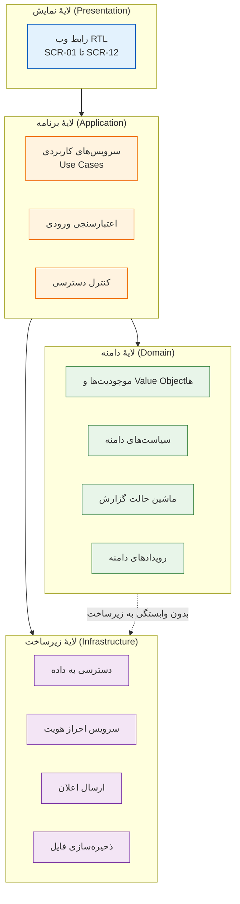
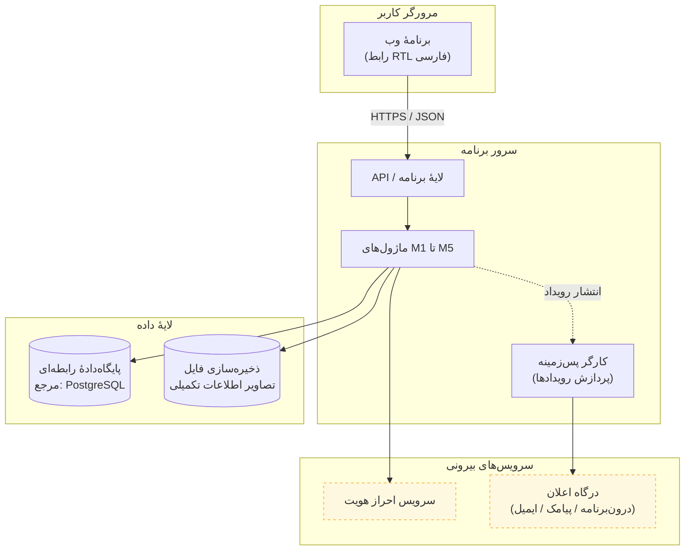
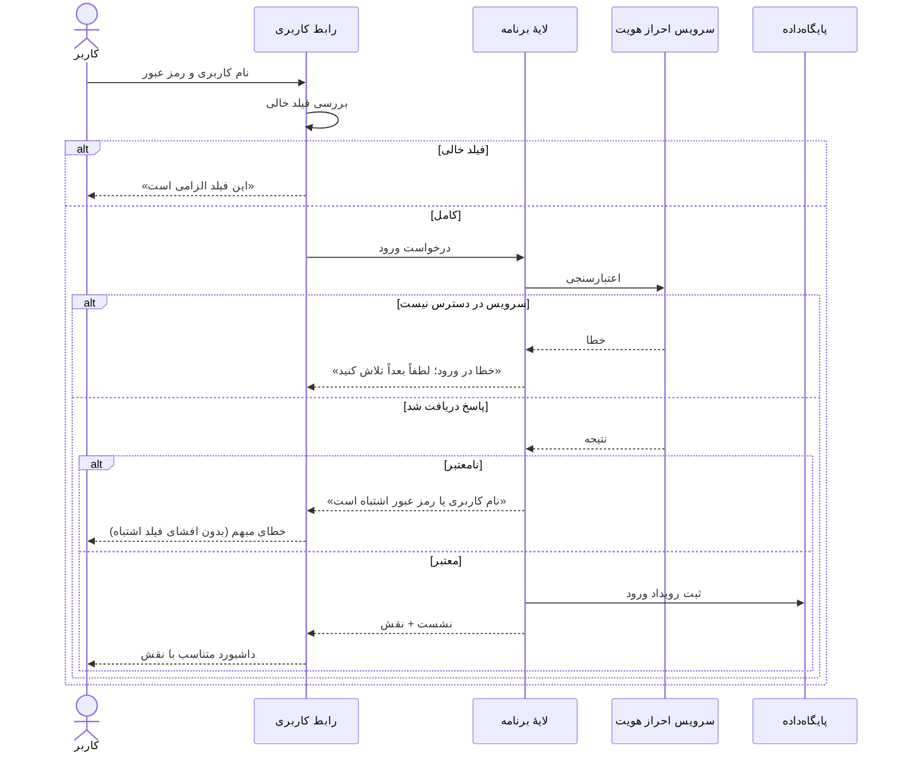
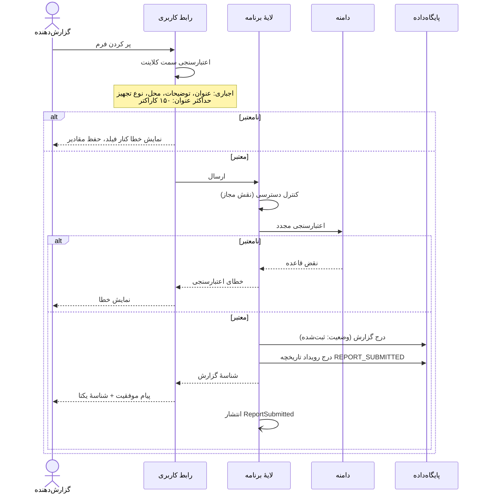
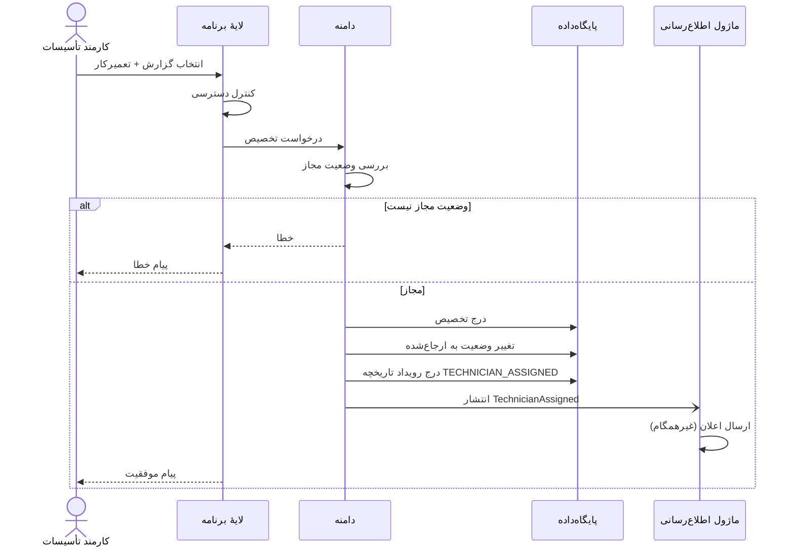
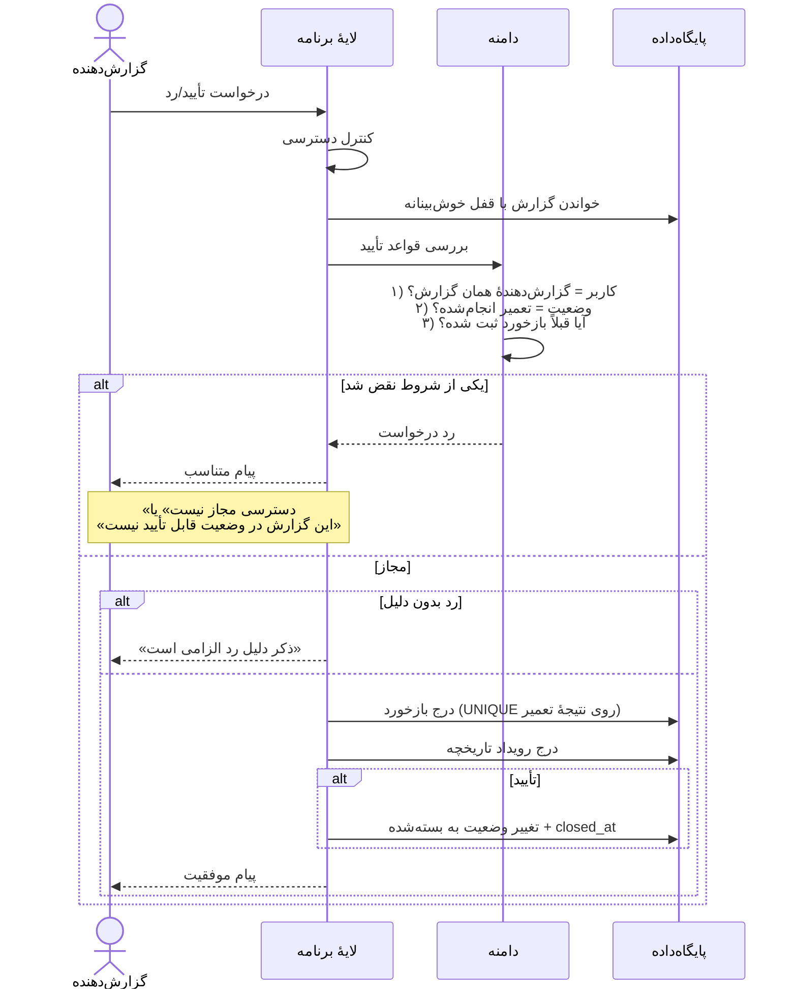
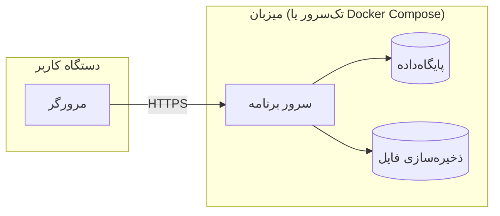

# معماری نرم‌افزار (Software Architecture) – سامانه مدیریت و گزارش خرابی دانشگاهی

**تهیه‌کننده:** امیرحسن عارف اصل  
**بازبین:** رضا آدوسی  
**آخرین به‌روزرسانی:** ۱۴۰۵/۰۸/۱۴

---

## مقدمه

این سند معماری نرم‌افزاری سامانهٔ مدیریت و گزارش خرابی دانشگاهی را در سطح **منطقی و مفهومی** تعریف می‌کند. چون پروژه هنوز وارد فاز پیاده‌سازی نشده است (طبق `README.md`)، این سند **تعهد به فناوری خاصی ندارد** و انتخاب‌های فناورانه در بخش «پرسش‌های باز» علامت‌گذاری شده‌اند.

هدف این سند پاسخ به سه پرسش است:

1. سامانه از چه **مؤلفه‌هایی** تشکیل می‌شود و مرز مسئولیت هر کدام کجاست؟
2. این مؤلفه‌ها چگونه با هم **همکاری** می‌کنند تا جریان‌های توصیف‌شده در `activity.md` محقق شوند؟
3. کدام **نیروهای محرک معماری (Architectural Drivers)** این ساختار را توجیه می‌کنند؟

## ۱. نیروهای محرک معماری

### ۱.۱. نیازمندی‌های غیرکارکردی

| شناسه | نیازمندی | اثر معماری |
|---|---|---|
| `NFR-01` | امنیت اطلاعات | احراز هویت متمرکز، مجوزدهی سمت سرور، هش رمز، جلوگیری از دسترسی مستقیم به صفحات نقش دیگر |
| `NFR-02` | حفظ حریم خصوصی | فیلتر داده بر اساس نقش در لایهٔ برنامه (نه فقط در رابط کاربری) |
| `NFR-03` | کاربردپذیری | رابط RTL فارسی، اعتبارسنجی درجا، پیام خطای روشن |
| `NFR-04` | زمان پاسخ‌گویی | ایندکس‌گذاری هدفمند (طبق `data-model.md` §۷)، پرهیز از کوئری‌های سنگین در داشبورد |
| `NFR-05` | صحت و نگهداری اطلاعات | تاریخچهٔ append-only، قفل خوش‌بینانه، تراکنش‌های اتمیک |
| `NFR-06` | قابلیت نگهداری و توسعه | معماری لایه‌ای و ماژولار، جداسازی دامنه از زیرساخت |

### ۱.۲. محدودیت‌ها

| محدودیت | منبع | اثر |
|---|---|---|
| تیم سه‌نفره، پروژهٔ دانشگاهی | `README.md` | پرهیز از معماری‌های توزیع‌شده و پیچیده |
| هنوز فناوری انتخاب نشده | `README.md` («هنوز کدنویسی و پیاده‌سازی انجام نشده») | معماری باید فناوری‌مستقل بماند |
| فهرست وضعیت‌ها و اولویت‌ها نهایی نیست | پرسش‌های باز ۳ و ۴ در `activity.md` | این‌ها باید **داده** باشند، نه کد |
| دامنهٔ فضاها مشخص نیست | ابهام `README.md` | مدل محل خرابی باید قابل گسترش بماند |

## ۲. سبک معماری انتخاب‌شده

**سبک پیشنهادی: مونولیت ماژولار لایه‌ای (Modular Layered Monolith)**

### ۲.۱. مقایسهٔ گزینه‌ها

| گزینه | مزیت | عیب | تناسب با این پروژه |
|---|---|---|---|
| **مونولیت لایه‌ای** | سادگی استقرار، دیباگ آسان، مناسب تیم کوچک | مقیاس‌پذیری مستقل ماژول‌ها ندارد | ✅ **انتخاب شد** |
| میکروسرویس | استقلال استقرار، مقیاس‌پذیری انتخابی | هزینهٔ عملیاتی بالا، نیاز به DevOps، پیچیدگی تراکنش توزیع‌شده | ❌ برای تیم سه‌نفره و پروژهٔ درسی توجیه ندارد |
| بدون لایه (اسکریپت‌محور) | سرعت شروع | نقض `NFR-06`، عدم قابلیت نگهداری | ❌ |

### ۲.۲. توجیه

- `NFR-06` قابلیت نگهداری را الزام می‌کند؛ لایه‌بندی این را تضمین می‌کند.
- `NFR-05` صحت داده را الزام می‌کند؛ تراکنش در یک پایگاه‌دادهٔ واحد بسیار ساده‌تر از تراکنش توزیع‌شده است.
- مرزهای دامنه (بخش ۳) از `domain-model.md` گرفته شده‌اند تا در آیندهٔ دور اگر لازم شد، جداسازی به میکروسرویس **ممکن** باشد، بدون بازنویسی دامنه.

## ۳. مرزهای ماژول (Bounded Contexts)

مرزها از `domain-model.md` §۱ گرفته شده‌اند:

| ماژول | مسئولیت | مفاهیم اصلی | نیازمندی‌ها |
|---|---|---|---|
| **M1 — هویت و دسترسی** | احراز هویت، تشخیص نقش، مجوزدهی | کاربر، نقش، نشست | `FR-01`، `FR-02`، `US-15` |
| **M2 — گزارش خرابی** | ثبت، پیگیری، اطلاعات تکمیلی، بازخورد گزارش‌دهنده | گزارش، اطلاعات تکمیلی، بازخورد | `FR-03`–`FR-05`، `FR-14`، `US-01`–`US-05` |
| **M3 — مدیریت تعمیر** | بررسی، اولویت‌بندی، تخصیص، ثبت نتیجه | اولویت، تخصیص، نتیجهٔ تعمیر | `FR-06`–`FR-13`، `US-06`–`US-14` |
| **M4 — اطلاع‌رسانی** | واکنش به رویدادهای دامنه و ارسال اعلان | اعلان، کانال | `FR-15`، `US-16` |
| **M5 — نظارت** | داشبورد و آمار تجمیعی | داشبورد (Read Model) | `FR-17`، `US-17` |

> **نکته:** M2 و M3 در `data-model.md` روی یک جدول مرکزی (`fault_reports`) کار می‌کنند. جداسازی این دو **ماژول منطقی** است، نه فیزیکی. مزیت: هر ماژول فقط متدهای مجاز خودش را روی گزارش فراخوانی می‌کند و قانون «تغییر وضعیت فقط از مسیر مجاز» در یک نقطه کنترل می‌شود.

## ۴. لایه‌های معماری

**قاعدهٔ وابستگی:** جهت وابستگی همیشه به سمت **دامنه** است. دامنه به هیچ لایهٔ دیگری وابسته نیست. این قاعده `NFR-06` را تضمین می‌کند و اجازه می‌دهد در آینده پایگاه‌داده یا سرویس احراز هویت عوض شود بدون تغییر منطق کسب‌وکار.

## ۵. نمای ظرف (Container View)

> **توضیح:** پردازش اعلان (M4) به‌صورت **غیرهمگام** از طریق رویداد انجام می‌شود تا `NFR-04` حفظ شود: ثبت گزارش نباید منتظر ارسال پیامک بماند. کانال دقیق اعلان هنوز پرسش باز ۸ است؛ بنابراین `NOTIF` به‌عنوان یک **آداپتور قابل تعویض** مدل شده است.

## ۶. جریان‌های کلیدی

### ۶.۱. ورود به سامانه (AD-01، US-15)

**الزامات امنیتی بازتاب‌یافته:** پیام خطا نباید مشخص کند کدام فیلد اشتباه است (`US-15.feature`). این قاعده در لایهٔ برنامه اعمال می‌شود، نه در رابط کاربری.

### ۶.۲. ثبت گزارش خرابی (AD-02، US-01، US-02)

**نکتهٔ مهم (الزام `US-01.feature`):** «اعتبارسنجی سمت کلاینت» فقط برای تجربهٔ کاربری است. اعتبارسنجی **معتبر** در لایهٔ برنامه و دامنه انجام می‌شود. اگر درخواست مستقیماً به API ارسال شود، همان قواعد باید اعمال شوند.

### ۶.۳. تخصیص تعمیرکار (AD-03، US-08)

### ۶.۴. تأیید یا رد تعمیر (AD-05، US-05)

**چرا قفل خوش‌بینانه؟** الزام ایدمپوتنسی در `US-05.feature`: «کلیک دوباره روی تأیید یک تغییر وضعیت بیشتر ایجاد نمی‌کند». ترکیب `UNIQUE (report_id, repair_result_id)` در `data-model.md` و بررسی `version` تضمین دوگانه می‌دهد.

## ۷. دغدغه‌های عرضی (Cross-Cutting Concerns)

| دغدغه | راهکار | لایه | مستند مرجع |
|---|---|---|---|
| **احراز هویت** | سرویس متمرکز؛ در صورت در دسترس نبودن، پیام «خطا در ورود؛ لطفاً بعداً تلاش کنید» و عدم ورود | برنامه | `FR-01`، `US-15.feature` |
| **مجوزدهی** | کنترل سمت سرور در **هر** درخواست؛ هرگز فقط مخفی‌کردن دکمه در رابط کاربری | برنامه | `FR-02`، `US-15.feature` |
| **اعتبارسنجی** | دو لایه: رابط کاربری (تجربهٔ کاربری) و دامنه (اعتبار واقعی) | نمایش + دامنه | `US-01.feature` |
| **ثبت تاریخچه** | هر تغییر معنادار یک ردیف در `report_history`؛ append-only | برنامه + داده | `FR-16`، `NFR-05` |
| **رویدادهای دامنه** | انتشار پس از commit موفق؛ مصرف غیرهمگام | دامنه → اطلاع‌رسانی | `FR-15` |
| **مدیریت خطا** | خطاهای قابل نمایش (اعتبارسنجی/مجوز) در برابر خطاهای فنی؛ در خطای فنی، پیام عمومی و ثبت جزئیات در لاگ | برنامه | `US-01.feature` |
| **زمان** | همهٔ زمان‌ها با منطقهٔ زمانی (`timestamptz`) | داده | `data-model.md` §۹ |
| **تراکنش** | تغییر وضعیت + درج تاریخچه در یک تراکنش | برنامه + داده | `NFR-05` |

## ۸. تصمیم‌های معماری (ADR)

| شناسه | تصمیم | جایگزین ردشده | دلیل |
|---|---|---|---|
| **ADR-01** | مونولیت ماژولار | میکروسرویس | تیم سه‌نفره، نیاز به تراکنش اتمیک، `NFR-06` |
| **ADR-02** | معماری لایه‌ای با وابستگی به سمت دامنه | لایه‌بندی بدون قاعده | جلوگیری از نشت منطق کسب‌وکار به رابط کاربری |
| **ADR-03** | مجوزدهی **سمت سرور** در هر درخواست | فقط مخفی‌کردن در رابط کاربری | `FR-02`، `US-15.feature` (سناریوی دسترسی مستقیم به آدرس) |
| **ADR-04** | اعلان بر پایهٔ **رویداد دامنه** و غیرهمگام | فراخوانی مستقیم ارسال اعلان در همان تراکنش | `NFR-04`، جداسازی M4 از M2/M3 |
| **ADR-05** | قفل خوش‌بینانه (`version`) | قفل بدبینانه | ایدمپوتنسی `US-05.feature` بدون بلوکه‌کردن |
| **ADR-06** | فهرست وضعیت‌ها و انتقال‌ها به‌صورت **داده** | `ENUM` یا `switch` در کد | پرسش‌های باز ۳ و ۴ هنوز بسته نشده‌اند |
| **ADR-07** | تاریخچهٔ append-only | لاگ فایل یا `audit` سطح پایگاه‌داده | قابل مشاهده برای کاربر (`FR-16`، `US-10`) |
| **ADR-08** | شناسه‌های فنی انگلیسی، متن رابط فارسی | همه‌چیز فارسی | تعارض با `CONTRIBUTING.md` ندارد؛ آن بند دربارهٔ متن مستندات است |

## ۹. نمای استقرار (Deployment View)

**فرض:** برای یک پروژهٔ دانشگاهی، استقرار تک‌سروری (یا `docker compose` با سه سرویس) کافی است. جزئیات فناورانه در پرسش‌های باز آمده‌اند.

## ۱۰. نگاشت نیازمندی‌های غیرکارکردی به راهکار معماری

| NFR | راهکار معماری | محل تحقق |
|---|---|---|
| `NFR-01` امنیت | احراز هویت متمرکز، مجوزدهی سمت سرور، هش رمز، عدم افشای فیلد اشتباه | `M1`، لایهٔ برنامه |
| `NFR-02` حریم خصوصی | فیلتر نتایج بر اساس نقش در سرویس‌های کاربردی | لایهٔ برنامه |
| `NFR-03` کاربردپذیری | رابط RTL، اعتبارسنجی درجا، پیام‌های دقیق | لایهٔ نمایش (`ui-wireframes.md`) |
| `NFR-04` زمان پاسخ | ایندکس‌های `data-model.md` §۷، اعلان غیرهمگام، داشبورد به‌صورت نمای تجمیعی | داده + `M4` + `M5` |
| `NFR-05` صحت داده | تراکنش اتمیک، تاریخچهٔ append-only، قفل خوش‌بینانه، ممنوعیت حذف فیزیکی | دامنه + داده |
| `NFR-06` نگهداشت | لایه‌بندی، مرز ماژول، جداسازی دامنه از زیرساخت، ADRها | کل معماری |

## ۱۱. ریسک‌های معماری

| # | ریسک | اثر | کاهش |
|---|---|---|---|
| R1 | بسته‌نشدن پرسش باز ۹ (چند نقش برای کاربر) | تغییر در M1 و مدل داده و نمودار کلاس | تصمیم‌گیری پیش از پیاده‌سازی؛ در غیر این صورت تغییر سه سند |
| R2 | نهایی‌نشدن فهرست وضعیت‌ها (پرسش ۴) | تغییر ماشین حالت و انتقال‌های مجاز | ADR-06: انتقال‌ها به‌صورت داده |
| R3 | رشد دامنه به خوابگاه و فضاهای اداری | تأثیر بر مدل محل و مجوزها | مدل محل قابل گسترش (`data-model.md` D2) |
| R4 | انتخاب نشدن کانال اعلان (پرسش ۸) | تأخیر در `M4` | آداپتور قابل تعویض (بخش ۵) |
| R5 | انتخاب‌نشدن فناوری | عدم شروع پیاده‌سازی | پرسش باز ۱۶ |

## ۱۲. نکات و پرسش‌های باز

| # | پرسش | نیازمند تصمیم |
|---|---|---|
| ۱۶ | فناوری لایهٔ نمایش، برنامه و داده چیست؟ (زبان، فریم‌ورک، DBMS) | تیم — پیش از فاز پیاده‌سازی |
| ۱۷ | سرویس احراز هویت داخلی ساخته شود یا از راهکار آماده استفاده شود؟ | تیم |
| ۱۸ | ذخیره‌سازی تصاویر اطلاعات تکمیلی در فایل‌سیستم یا پایگاه‌داده؟ | تیم |
| ۱۹ | نیاز به API عمومی یا صرفاً مصرف داخلی رابط کاربری؟ | تیم |
| ۲۰ | سطح دسترسی دقیق مدیر (پرسش باز ۹ در `activity.md`) چه اثری بر M1 و M5 دارد؟ | تیم |
| ۲۱ | آیا نیاز به ثبت تلاش‌های ورود ناموفق و قفل حساب وجود دارد؟ (در مستندات نیامده) | تیم |
| ۲۲ | آیا رابط کاربری باید واکنش‌گرا (Responsive) باشد؟ (در `NFR-03` صریح نیست) | تیم |

---

**وضعیت سند:** نسخه اولیه (Draft) – آماده بازبینی