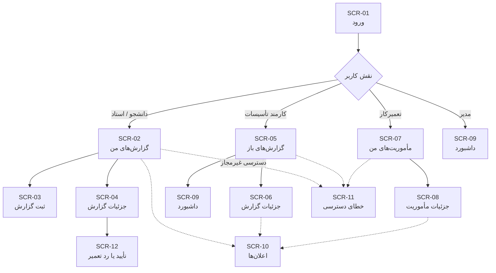

# رابط کاربری و وایرفریم‌ها (UI Wireframes) – سامانه مدیریت و گزارش خرابی دانشگاهی


**تهیه‌کننده:** ارشیا همتی‌زاده  
**بازبین:** رضا آدوسی  
**آخرین به‌روزرسانی:** ۱۴۰۵/۰۸/۱۴


---

## مقدمه

این سند فهرست صفحات، نقشهٔ ناوبری و طرح اولیهٔ چیدمان (Wireframe) رابط کاربری سامانه را ارائه می‌دهد. هدف، تبدیل داستان‌های کاربر و جریان‌های `activity.md` به صفحات مشخص است، **پیش از** انتخاب فناوری و شروع کدنویسی.

> **نکتهٔ نمایش:** متن نهایی سامانه فارسی و راست‌به‌چپ (RTL) است. طرح‌های این سند با کاراکترهای ساده رسم شده‌اند و **جهت چیدمان آن‌ها نمایندهٔ جهت نهایی نیست**. در پیاده‌سازی، ستون «منو/اقدام» در سمت راست و ناحیهٔ محتوا در سمت چپ قرار می‌گیرد.

## ۱. اصول طراحی

| # | اصل | توضیح | مستند مرجع |
|---|---|---|---|
| P1 | **راست‌به‌چپ و فارسی** | همهٔ برچسب‌ها، پیام‌ها و تاریخ‌ها فارسی؛ تاریخ شمسی با ارقام فارسی | `NFR-03`، `CONTRIBUTING.md` §۷ |
| P2 | **ناوبری نقش‌محور** | هر کاربر فقط صفحات نقش خود را در منو می‌بیند | `FR-02`، `US-15` |
| P3 | **اعتبارسنجی درجا** | خطا کنار همان فیلد نمایش داده می‌شود، نه در بالای صفحه | `US-01.feature` |
| P4 | **حفظ ورودی در خطا** | در خطای اعتبارسنجی یا خطای سرور، مقادیر فرم پاک نمی‌شوند | `US-01.feature` |
| P5 | **افشا نکردن علت خطای ورود** | پیام ورود مبهم است و فیلد اشتباه را مشخص نمی‌کند | `US-15.feature` |
| P6 | **پنهان‌نکردن قابلیت به‌جای کنترل دسترسی** | مجوزدهی سمت سرور؛ رابط کاربری فقط بازتاب آن است | `ADR-03` در `software-architecture.md` |
| P7 | **بازخورد صریح وضعیت** | هر اقدام موفق یا ناموفق پیام روشن دارد | `NFR-03` |
| P8 | **نمایش وضعیت و اولویت به‌صورت بصری** | بج رنگی برای وضعیت و اولویت در همهٔ فهرست‌ها | `FR-08`، `US-06` |

## ۲. فهرست صفحات

| شناسه | صفحه | نقش‌های مجاز | داستان‌های کاربر | جریان فعالیت |
|---|---|---|---|---|
| `SCR-01` | ورود به سامانه | همه | `US-15` | `AD-01` |
| `SCR-02` | گزارش‌های من | دانشجو، استاد | `US-03` | `AD-02` |
| `SCR-03` | ثبت گزارش خرابی | دانشجو، استاد | `US-01`، `US-02` | `AD-02` |
| `SCR-04` | جزئیات گزارش (نمای گزارش‌دهنده) | دانشجو، استاد | `US-03`، `US-04`، `US-05` | `AD-02`، `AD-05` |
| `SCR-05` | فهرست گزارش‌های باز | کارمند تأسیسات | `US-06` | `AD-03` |
| `SCR-06` | جزئیات گزارش (نمای تأسیسات) | کارمند تأسیسات | `US-06`–`US-10` | `AD-03` |
| `SCR-07` | مأموریت‌های من | تعمیرکار | `US-11` | `AD-04` |
| `SCR-08` | جزئیات مأموریت | تعمیرکار | `US-12`، `US-13`، `US-14` | `AD-04` |
| `SCR-09` | داشبورد مدیریتی | کارمند تأسیسات، مدیر | `US-17` | `AD-03` |
| `SCR-10` | اعلان‌ها | همه | `US-16` | — |
| `SCR-11` | خطای دسترسی | همه | `US-15` | `AD-01` |
| `SCR-12` | مودال تأیید/رد تعمیر | دانشجو، استاد | `US-05` | `AD-05` |

## ۳. نقشهٔ ناوبری



## ۴. وایرفریم‌ها

در هر طرح، کادرهای شماره‌دار به عناصر مشخص اشاره دارند و جدول زیر آن‌ها مشخصات کامل هر عنصر را می‌دهد. این روش از مشکل نمایش راست‌به‌چپ متن فارسی در بلوک کد جلوگیری می‌کند.

### ۴.۱. `SCR-01` — ورود به سامانه

```text
┌──────────────────────────────────────────────────────────────┐
│  [۱]                                                    [۲]  │
│                                                              │
│                  ┌────────────────────────┐                  │
│                  │        [۳]             │                  │
│                  │                        │                  │
│                  │  [۴]                   │                  │
│                  │  ┌──────────────────┐  │                  │
│                  │  │ [۵]              │  │                  │
│                  │  └──────────────────┘  │                  │
│                  │  [۶]                   │                  │
│                  │  ┌──────────────────┐  │                  │
│                  │  │ [۷]              │  │                  │
│                  │  └──────────────────┘  │                  │
│                  │  [۸]                   │                  │
│                  │  ┌──────────────────┐  │                  │
│                  │  │      [۹]         │  │                  │
│                  │  └──────────────────┘  │                  │
│                  └────────────────────────┘                  │
│                                                              │
└──────────────────────────────────────────────────────────────┘
```

| # | عنصر | نوع | محتوا | رفتار | مرجع |
|---|---|---|---|---|---|
| ۱ | لوگو و نام سامانه | متن | «سامانه مدیریت و گزارش خرابی دانشگاهی» | — | `README.md` |
| ۲ | فضای خالی / زبان | — | فعلاً فقط فارسی | — | `NFR-03` |
| ۳ | عنوان فرم | تیتر | «ورود به سامانه» | — | `US-15` |
| ۴ | برچسب نام کاربری | متن | «نام کاربری» | — | `FR-01` |
| ۵ | ورودی نام کاربری | فیلد متنی | — | اجباری؛ در صورت خالی‌بودن: «این فیلد الزامی است» کنار فیلد | `US-15.feature` |
| ۶ | برچسب رمز عبور | متن | «رمز عبور» | — | `FR-01` |
| ۷ | ورودی رمز عبور | فیلد رمز | — | اجباری؛ ماسک‌شده | `US-15.feature` |
| ۸ | ناحیهٔ خطا | ناحیهٔ پیام | خالی در حالت عادی | در خطای ورود: «نام کاربری یا رمز عبور اشتباه است» — نام کاربری در فرم می‌ماند | `US-15.feature` |
| ۹ | دکمهٔ ورود | دکمهٔ اصلی | «ورود» | پس از موفقیت: انتقال به داشبورد نقش | `AD-01` |

**حالت‌های خطا:**

| حالت | پیام | رفتار | مرجع |
|---|---|---|---|
| فیلد خالی | «این فیلد الزامی است» (کنار همان فیلد) | ورود انجام نمی‌شود | `US-15.feature` |
| اعتبارنامهٔ نامعتبر | «نام کاربری یا رمز عبور اشتباه است» | نام کاربری حفظ می‌شود؛ فیلد اشتباه مشخص نمی‌شود | `US-15.feature` |
| سرویس احراز هویت در دسترس نیست | «خطا در ورود؛ لطفاً بعداً تلاش کنید» | ورود انجام نمی‌شود | `US-15.feature` |

> **الزام امنیتی:** هیچ پیام خطایی نباید مشخص کند «نام کاربری وجود ندارد» یا «رمز اشتباه است». تنها پیام مشترک مجاز است (P5).

### ۴.۲. `SCR-03` — ثبت گزارش خرابی

```text
┌──────────────────────────────────────────────────────────────┐
│  [۱]                                                    [۲]  │
├──────────────┬───────────────────────────────────────────────┤
│              │  [۳]                                          │
│   [M1]       │  ┌──────────────────────────────────────────┐ │
│   [M2]       │  │ [۴]                                      │ │
│   [M3]       │  │ ┌──────────────────────────────────────┐ │ │
│   [M4]       │  │ │ [۵]                                  │ │ │
│              │  │ └──────────────────────────────────────┘ │ │
│              │  │ [۶]                                      │ │
│              │  │ ┌──────────────────────────────────────┐ │ │
│              │  │ │ [۷]                                  │ │ │
│              │  │ │                                      │ │ │
│              │  │ └──────────────────────────────────────┘ │ │
│              │  │ [۸]                                      │ │ │
│              │  │ ┌──────────────────────────────────────┐ │ │
│              │  │ │ [۹]                                  │ │ │
│              │  │ └──────────────────────────────────────┘ │ │
│              │  │ [۱۰]                                     │ │ │
│              │  │ ┌──────────────────────────────────────┐ │ │
│              │  │ │ [۱۱]                                 │ │ │
│              │  │ └──────────────────────────────────────┘ │ │
│              │  │                          [۱۲]    [۱۳]    │ │
│              │  └──────────────────────────────────────────┘ │
└──────────────┴───────────────────────────────────────────────┘
```

| # | عنصر | نوع | محتوا | رفتار | مرجع |
|---|---|---|---|---|---|
| ۱ | نوار بالا | ناحیه | نام کاربر + خروج | — | `FR-01` |
| ۲ | زنگ اعلان | آیکون + شمارنده | تعداد خوانده‌نشده | کلیک → `SCR-10` | `US-16` |
| M1–M4 | منوی نقش | فهرست | «گزارش‌های من»، «ثبت گزارش»، «اعلان‌ها»، «خروج» | فقط آیتم‌های مجاز نقش | `FR-02` |
| ۳ | عنوان صفحه | تیتر | «ثبت گزارش خرابی» | — | `US-01`، `US-02` |
| ۴ | برچسب عنوان | متن | «عنوان» + نشان اجباری | — | `FR-03` |
| ۵ | ورودی عنوان | فیلد متنی | — | اجباری؛ حداکثر ۱۵۰ کاراکتر؛ شمارندهٔ کاراکتر | `US-01.feature` |
| ۶ | برچسب توضیحات | متن | «توضیحات» + نشان اجباری | — | `FR-03` |
| ۷ | ورودی توضیحات | ناحیهٔ متنی | — | اجباری | `US-01.feature` |
| ۸ | برچسب محل خرابی | متن | «محل خرابی» + نشان اجباری | — | `FR-03` |
| ۹ | ورودی محل | فیلد متنی | نمونه: «ساختمان الف - کلاس ۱۰۲» | اجباری | `US-01.feature` |
| ۱۰ | برچسب نوع تجهیز | متن | «نوع تجهیز» + نشان اجباری | — | `FR-03` |
| ۱۱ | انتخاب نوع تجهیز | فهرست کشویی | روشنایی، تهویه، آسانسور، برق، پروژکتور، سایر | اجباری | `US-01.feature`، `README.md` |
| ۱۲ | دکمهٔ انصراف | دکمهٔ ثانویه | «انصراف» | بازگشت به `SCR-02` | — |
| ۱۳ | دکمهٔ ثبت | دکمهٔ اصلی | «ثبت گزارش» | ارسال؛ در انتظار: غیرفعال + نشانگر | `AD-02` |

**حالت‌های نتیجه:**

| حالت | پیام | رفتار | مرجع |
|---|---|---|---|
| موفقیت | نمایش شناسهٔ یکتا | انتقال به `SCR-04` یا ماندن با پیام موفقیت | `US-01.feature` |
| فیلد اجباری خالی | «این فیلد الزامی است» کنار فیلد | هیچ گزارشی ذخیره نمی‌شود | `US-01.feature` |
| عنوان ۱۵۱ کاراکتر | «حداکثر طول عنوان ۱۵۰ کاراکتر است» | هیچ گزارشی ذخیره نمی‌شود | `US-01.feature` |
| خطای سرور | «خطا در ثبت گزارش؛ لطفاً دوباره تلاش کنید» | **مقادیر فرم حفظ می‌شوند**، هیچ گزارش ناقصی ذخیره نمی‌شود | `US-01.feature` |

> **الزام P4:** در حالت خطای سرور، پاک‌کردن فرم **ممنوع** است. این رفتار در `US-01.feature` صریحاً الزام شده است.

### ۴.۳. `SCR-05` — فهرست گزارش‌های باز (کارمند تأسیسات)

```text
┌──────────────────────────────────────────────────────────────┐
│  [۱]                                                    [۲]  │
├──────────────┬───────────────────────────────────────────────┤
│              │  [۳]                                          │
│   [M1]       │  [۴]  [۵]  [۶]  [۷]                          │
│   [M2]       │  ┌──────────────────────────────────────────┐ │
│   [M3]       │  │ [۸] │ [۹] │ [۱۰] │ [۱۱] │ [۱۲] │ [۱۳]  │ │
│              │  ├──────────────────────────────────────────┤ │
│              │  │  ...                                     │ │
│              │  │  ...                                     │ │
│              │  │  ...                                     │ │
│              │  └──────────────────────────────────────────┘ │
│              │  [۱۴]                                         │
└──────────────┴───────────────────────────────────────────────┘
```

| # | عنصر | نوع | محتوا | رفتار | مرجع |
|---|---|---|---|---|---|
| ۱ | نوار بالا | ناحیه | نام کاربر + خروج | — | — |
| ۲ | زنگ اعلان | آیکون | — | → `SCR-10` | `US-16` |
| M1–M4 | منوی نقش | فهرست | «گزارش‌های باز»، «داشبورد»، «اعلان‌ها»، «خروج» | — | `FR-02` |
| ۳ | عنوان صفحه | تیتر | «گزارش‌های باز» | — | `US-06` |
| ۴ | فیلتر وضعیت | کشویی چندگزینه | از `report_statuses` | پیش‌فرض: همه به‌جز «بسته‌شده» | `FR-08`، `US-06` |
| ۵ | فیلتر اولویت | کشویی چندگزینه | از `priorities` | — | `FR-08` |
| ۶ | جست‌وجو | فیلد متنی | جست‌وجو در عنوان و شناسه | — | `FR-08` |
| ۷ | دکمهٔ پاک‌کردن فیلتر | دکمهٔ ثانویه | «پاک‌کردن فیلترها» | بازنشانی | — |
| ۸ | ستون شناسه | ستون جدول | `report_no` | قابل مرتب‌سازی | — |
| ۹ | ستون عنوان | ستون جدول | عنوان گزارش | لینک به `SCR-06` | — |
| ۱۰ | ستون محل | ستون جدول | محل خرابی | — | `FR-03` |
| ۱۱ | ستون اولویت | ستون جدول | بج اولویت | رنگ‌بندی بر اساس سطح | `FR-07` |
| ۱۲ | ستون وضعیت | ستون جدول | بج وضعیت | رنگ‌بندی بر اساس وضعیت | `FR-11` |
| ۱۳ | ستون تاریخ | ستون جدول | تاریخ ثبت (شمسی) | مرتب‌سازی پیش‌فرض: نزولی | — |
| ۱۴ | صفحه‌بندی | ناحیه | تعداد در صفحه | — | `NFR-04` |

> **تعریف «باز»:** گزارشی که وضعیت آن «بسته‌شده» نیست. «باز» یک وضعیت رسمی نیست (`data-model.md` §۴.۲).

### ۴.۴. `SCR-06` — جزئیات گزارش (نمای تأسیسات)

```text
┌──────────────────────────────────────────────────────────────┐
│  [۱]                                                    [۲]  │
├──────────────┬───────────────────────────────────────────────┤
│   [M1]       │  [۳]  [۴]  [۵]                                │
│   [M2]       │  ┌──────────────────┬────────────────────────┐ │
│   [M3]       │  │ [۶]              │ [۷]                    │ │
│              │  │ [۸]              │ [۹]                    │ │
│              │  │ [۱۰]             │ [۱۱]                   │ │
│              │  │ [۱۲]             │ [۱۳]                   │ │
│              │  │                  │ [۱۴]                   │ │
│              │  │                  │ [۱۵]                   │ │
│              │  └──────────────────┴────────────────────────┘ │
│              │  [۱۶]                                         │
│              │  ┌──────────────────────────────────────────┐ │
│              │  │  ...                                     │ │
│              │  └──────────────────────────────────────────┘ │
└──────────────┴───────────────────────────────────────────────┘
```

| # | عنصر | نوع | محتوا | رفتار | مرجع |
|---|---|---|---|---|---|
| ۳ | عنوان گزارش | تیتر | عنوان + شناسه | — | `FR-03` |
| ۴ | بج وضعیت | بج | وضعیت جاری | — | `FR-11` |
| ۵ | بج اولویت | بج | اولویت (در صورت تعیین) | — | `FR-07` |
| ۶ | توضیحات | متن | توضیحات گزارش‌دهنده | — | `FR-03` |
| ۷ | محل خرابی | متن | متن محل | — | `FR-03` |
| ۸ | نوع تجهیز | متن | برچسب فارسی نوع | — | `FR-03` |
| ۹ | گزارش‌دهنده | متن | نام نمایشی + نقش | — | — |
| ۱۰ | تاریخ ثبت | متن | تاریخ شمسی | — | — |
| ۱۱ | اطلاعات تکمیلی | فهرست | متن/تصویر + ارائه‌دهنده + زمان | — | `FR-04`، `US-04` |
| ۱۲ | نتیجهٔ تعمیر | ناحیه | توضیحات + تعمیرکار + زمان | فقط در صورت وجود | `FR-12` |
| ۱۳ | تعیین اولویت | کشویی + دکمه | «ذخیرهٔ اولویت» | فقط نقش تأسیسات | `FR-07`، `US-07` |
| ۱۴ | تخصیص تعمیرکار | کشویی + دکمه | فهرست تعمیرکاران + «تخصیص» | فقط نقش تأسیسات | `FR-09`، `US-08` |
| ۱۵ | تغییر وضعیت | کشویی + دکمه | فقط انتقال‌های مجاز | گزینه‌های غیرمجاز نمایش داده نمی‌شوند | `FR-11`، `US-09` |
| ۱۶ | تاریخچه | تایم‌لاین | فهرست اقدامات به ترتیب زمانی | — | `FR-16`، `US-10` |

> **الزام ADR-06:** گزینه‌های کشویی «تغییر وضعیت» باید از جدول انتقال‌های مجاز خوانده شوند، نه از کد. انتقال‌های نامشخص (پرسش‌های باز ۶ و ۷) نباید در رابط کاربری ظاهر شوند تا زمانی که تیم تصمیم بگیرد.

### ۴.۵. `SCR-07` — مأموریت‌های من (تعمیرکار)

```text
┌──────────────────────────────────────────────────────────────┐
│  [۱]                                                    [۲]  │
├──────────────┬───────────────────────────────────────────────┤
│   [M1]       │  [۳]                                          │
│   [M2]       │  ┌──────────────────────────────────────────┐ │
│              │  │ [۴] │ [۵] │ [۶] │ [۷] │ [۸] │ [۹]     │ │
│              │  ├──────────────────────────────────────────┤ │
│              │  │  ...                                     │ │
│              │  └──────────────────────────────────────────┘ │
└──────────────┴───────────────────────────────────────────────┘
```

| # | عنصر | نوع | محتوا | رفتار | مرجع |
|---|---|---|---|---|---|
| ۳ | عنوان صفحه | تیتر | «مأموریت‌های من» | — | `US-11` |
| ۴ | ستون شناسه | ستون | `report_no` | — | — |
| ۵ | ستون عنوان | ستون | عنوان گزارش | لینک به `SCR-08` | — |
| ۶ | ستون محل | ستون | محل خرابی | — | — |
| ۷ | ستون اولویت | ستون | بج اولویت | — | `FR-07` |
| ۸ | ستون وضعیت | ستون | وضعیت تخصیص | — | `US-12`، `US-13` |
| ۹ | ستون زمان تخصیص | ستون | تاریخ شمسی | — | — |

> **واژه‌شناسی:** «مأموریت» در `US-11` و `AD-04` همان «تخصیص» در `FR-09` است. رابط کاربری از واژهٔ «مأموریت» استفاده می‌کند چون زبان تعمیرکار است.

### ۴.۶. `SCR-08` — جزئیات مأموریت (تعمیرکار)

```text
┌──────────────────────────────────────────────────────────────┐
│  [۱]                                                    [۲]  │
├──────────────┬───────────────────────────────────────────────┤
│   [M1]       │  [۳]  [۴]                                     │
│              │  ┌──────────────────────────────────────────┐ │
│              │  │ [۵]  [۶]  [۷]                            │ │
│              │  └──────────────────────────────────────────┘ │
│              │  [۸]                                          │
│              │  ┌──────────────────────────────────────────┐ │
│              │  │ [۹]                                      │ │
│              │  └──────────────────────────────────────────┘ │
│              │  [۱۰]  [۱۱]  [۱۲]                            │
│              │  [۱۳]                                         │
│              │  ┌──────────────────────────────────────────┐ │
│              │  │  ...                                     │ │
│              │  └──────────────────────────────────────────┘ │
└──────────────┴───────────────────────────────────────────────┘
```

| # | عنصر | نوع | محتوا | رفتار | مرجع |
|---|---|---|---|---|---|
| ۳ | عنوان + شناسه | تیتر | — | — | — |
| ۴ | بج وضعیت | بج | — | — | `FR-11` |
| ۵ | توضیحات خرابی | متن | — | — | `FR-03` |
| ۶ | محل خرابی | متن | — | — | — |
| ۷ | نوع تجهیز | متن | — | — | — |
| ۸ | دکمهٔ «شروع تعمیر» | دکمه | فقط در وضعیت «ارجاع‌شده» | تغییر وضعیت به «در حال تعمیر» | `US-12` |
| ۹ | فرم ثبت نتیجه | ناحیهٔ متنی + دکمه | توضیحات اقدامات | فقط پس از شروع تعمیر | `FR-12`، `US-13` |
| ۱۰ | دکمهٔ «ثبت نتیجه» | دکمهٔ اصلی | — | تغییر وضعیت به «تعمیر انجام‌شده» | `US-13` |
| ۱۱ | دکمهٔ «درخواست اطلاعات» | دکمهٔ ثانویه | — | باز شدن فرم درخواست | `FR-13`، `US-14` |
| ۱۲ | فرم درخواست اطلاعات | ناحیهٔ متنی + دکمه | متن درخواست | ارسال به گزارش‌دهنده | `US-14`، `AD-04` |
| ۱۳ | تاریخچه | تایم‌لاین | — | — | `FR-16` |

> **پرسش باز ۶:** مکانیزم دقیق «انتظار برای دریافت اطلاعات» در `AD-04` علامت‌گذاری شده است. آیا وضعیت گزارش باید تغییر کند؟ تا تصمیم‌گیری، رابط کاربری فقط نشانگر «در انتظار پاسخ» نمایش می‌دهد و وضعیت گزارش را تغییر نمی‌دهد.

### ۴.۷. `SCR-09` — داشبورد مدیریتی

```text
┌──────────────────────────────────────────────────────────────┐
│  [۱]                                                    [۲]  │
├──────────────┬───────────────────────────────────────────────┤
│   [M1]       │  [۳]                                          │
│   [M2]       │  ┌───────────┬───────────┬───────────┐        │
│              │  │    [۴]    │    [۵]    │    [۶]    │        │
│              │  └───────────┴───────────┴───────────┘        │
│              │  [۷]                                          │
│              │  ┌──────────────────────────────────────────┐ │
│              │  │ [۸]                                      │ │
│              │  └──────────────────────────────────────────┘ │
└──────────────┴───────────────────────────────────────────────┘
```

| # | عنصر | نوع | محتوا | مرجع |
|---|---|---|---|---|
| ۳ | عنوان | تیتر | «داشبورد» | `US-17` |
| ۴ | کارت آمار | کارت | تعداد گزارش‌های باز | `FR-17` |
| ۵ | کارت آمار | کارت | تعداد درخواست‌های فوری | `FR-17`، `US-17` |
| ۶ | کارت آمار | کارت | تعداد کل گزارش‌ها | `FR-17` |
| ۷ | نمودار / فهرست | ناحیه | توزیع گزارش‌ها بر اساس وضعیت | `FR-17` |
| ۸ | فهرست کوتاه | جدول | آخرین گزارش‌های فوری | `US-17` |

> **تفکیک نقش:** مدیر فقط مشاهده دارد (`FR-17`، `US-17`). کارمند تأسیسات علاوه بر داشبورد به `SCR-05` و `SCR-06` هم دسترسی دارد. سطح دسترسی کامل مدیر پرسش باز ۹ در `activity.md` است.

### ۴.۸. `SCR-12` — مودال تأیید یا رد تعمیر

```text
┌──────────────────────────────────────────────────────────────┐
│                        [۱]                                   │
│  ┌────────────────────────────────────────────────────────┐  │
│  │ [۲]                                                    │  │
│  │ [۳]                                                    │  │
│  │ ┌────────────────────────────────────────────────────┐ │  │
│  │ │ [۴]                                                │ │  │
│  │ └────────────────────────────────────────────────────┘ │  │
│  │ [۵]                                                    │  │
│  │                          [۶]        [۷]                │  │
│  └────────────────────────────────────────────────────────┘  │
└──────────────────────────────────────────────────────────────┘
```

| # | عنصر | نوع | محتوا | رفتار | مرجع |
|---|---|---|---|---|---|
| ۱ | پوشش پس‌زمینه | لایه | — | کلیک بیرون: بستن مودال | — |
| ۲ | عنوان مودال | تیتر | «تأیید یا رد تعمیر» | — | `US-05` |
| ۳ | نتیجهٔ تعمیر | متن | توضیحات ثبت‌شده | — | `FR-12` |
| ۴ | دلیل رد | ناحیهٔ متنی | فقط اگر «رد» انتخاب شود | اجباری در حالت رد | `US-05.feature` |
| ۵ | ناحیهٔ خطا | پیام | — | «ذکر دلیل رد الزامی است» | `US-05.feature` |
| ۶ | دکمهٔ تأیید | دکمهٔ اصلی | «تأیید تکمیل تعمیر» | بستن گزارش | `FR-14` |
| ۷ | دکمهٔ رد | دکمهٔ خطر | «رد تعمیر» | ثبت رد + پیگیری | `US-05.feature` |

**حالت‌های خطا:**

| حالت | پیام | رفتار | مرجع |
|---|---|---|---|
| رد بدون دلیل | «ذکر دلیل رد الزامی است» | وضعیت بدون تغییر می‌ماند | `US-05.feature` |
| کاربر غیرمجاز | «دسترسی مجاز نیست» | وضعیت بدون تغییر | `US-05.feature` |
| وضعیت نامناسب | «این گزارش در وضعیت قابل تأیید نیست» | عملیات انجام نمی‌شود | `US-05.feature` |
| کلیک دوباره | — | فقط یک تغییر وضعیت و یک ورودی تاریخچه | `US-05.feature` |

## ۵. اجزای مشترک (Component Inventory)

| شناسه | جزء | توضیح | استفاده در | مرجع |
|---|---|---|---|---|
| `CMP-01` | بج وضعیت | نمایش `label_fa` با رنگ متناظر | `SCR-02`، `SCR-04`، `SCR-05`، `SCR-06`، `SCR-07` | `FR-11` |
| `CMP-02` | بج اولویت | نمایش `label_fa` با رنگ متناظر | `SCR-05`، `SCR-06`، `SCR-07` | `FR-07` |
| `CMP-03` | جدول داده | ستون‌بندی، مرتب‌سازی، صفحه‌بندی | `SCR-02`، `SCR-05`، `SCR-07` | `NFR-04` |
| `CMP-04` | فیلد فرم با اعتبارسنجی | برچسب + نشان اجباری + پیام خطای درجا | `SCR-01`، `SCR-03`، `SCR-12` | `US-01.feature` |
| `CMP-05` | تایم‌لاین تاریخچه | فهرست رویدادهای `report_history` | `SCR-04`، `SCR-06`، `SCR-08` | `FR-16` |
| `CMP-06` | آپلود تصویر | انتخاب و پیش‌نمایش تصویر | `SCR-04` | `FR-04` |
| `CMP-07` | زنگ اعلان | شمارندهٔ خوانده‌نشده + لینک به `SCR-10` | همهٔ صفحات داخلی | `US-16` |
| `CMP-08` | نوار پیام | پیام موفقیت/خطای سطح صفحه | همهٔ صفحات | `NFR-03` |
| `CMP-09` | منوی نقش‌محور | آیتم‌های منو بر اساس نقش | همهٔ صفحات داخلی | `FR-02` |
| `CMP-10` | کادر تأیید | برای اقدام‌های برگشت‌ناپذیر (بستن گزارش) | `SCR-12` | `US-05` |

## ۶. قرارداد رنگی (پیشنهادی)

> رنگ‌ها **پیشنهادی** هستند و باید با پرسش باز ۲۴ تأیید شوند.

| وضعیت / اولویت | رنگ پیشنهادی | توضیح |
|---|---|---|
| ثبت‌شده | خاکستری | تازه ثبت شده، هنوز بررسی نشده |
| ارجاع‌شده | آبی | در انتظار شروع تعمیر |
| در حال تعمیر | نارنجی | در جریان |
| تعمیر انجام‌شده | سبز روشن | در انتظار بازخورد گزارش‌دهنده |
| بسته‌شده | سبز تیره | پایان یافته |
| اولویت کم | خاکستری | — |
| اولویت متوسط | آبی | — |
| اولویت زیاد | نارنجی | — |
| اولویت فوری | قرمز | باید در داشبورد برجسته شود (`US-17`) |

> **الزام دسترس‌پذیری:** رنگ نباید تنها حامل معنا باشد؛ متن برچسب همیشه در کنار رنگ نمایش داده می‌شود.

## ۷. پیام‌های استاندارد رابط کاربری

این جدول، **متن دقیق** پیام‌ها را از فایل‌های Feature استخراج کرده تا در پیاده‌سازی، متن تغییر نکند:

| شناسه | متن پیام | شرایط | مرجع |
|---|---|---|---|
| `MSG-01` | «این فیلد الزامی است» | فیلد اجباری خالی | `US-01.feature`، `US-15.feature` |
| `MSG-02` | «حداکثر طول عنوان ۱۵۰ کاراکتر است» | عنوان بیش از ۱۵۰ کاراکتر | `US-01.feature` |
| `MSG-03` | «خطا در ثبت گزارش؛ لطفاً دوباره تلاش کنید» | خطای سرور در ذخیره | `US-01.feature` |
| `MSG-04` | «نام کاربری یا رمز عبور اشتباه است» | اعتبارنامهٔ نامعتبر | `US-15.feature` |
| `MSG-05` | «خطا در ورود؛ لطفاً بعداً تلاش کنید» | سرویس احراز هویت در دسترس نیست | `US-15.feature` |
| `MSG-06` | «دسترسی مجاز نیست» | تلاش برای دسترسی غیرمجاز | `US-15.feature`، `US-05.feature` |
| `MSG-07` | «ذکر دلیل رد الزامی است» | رد تعمیر بدون دلیل | `US-05.feature` |
| `MSG-08` | «این گزارش در وضعیت قابل تأیید نیست» | تأیید در وضعیت نامناسب | `US-05.feature` |

## ۸. نکات و پرسش‌های باز

| # | پرسش | اثر |
|---|---|---|
| ۲۳ | فناوری و فریم‌ورک رابط کاربری چیست؟ | تعیین روش پیاده‌سازی همهٔ صفحات |
| ۲۴ | پالت رنگی و هویت بصری دانشگاه چیست؟ | بخش ۶ موقت است |
| ۲۵ | آیا رابط کاربری باید واکنش‌گرا (موبایل) باشد؟ | در `NFR-03` صریح نیست؛ بر چیدمان جدول‌ها اثر دارد |
| ۲۶ | سطح دسترسی دقیق مدیر (پرسش باز ۹ در `activity.md`) چیست؟ | تعیین آیتم‌های منوی مدیر |
| ۲۷ | آیا گزارش‌دهنده می‌تواند در هر زمان اطلاعات تکمیلی اضافه کند یا فقط پس از درخواست؟ | رفتار دکمهٔ «افزودن اطلاعات» در `SCR-04` |
| ۲۸ | کانال اعلان (پرسش باز ۸) چیست؟ | محتوای `SCR-10` و `CMP-07` |
| ۲۹ | آیا صفحهٔ «پروفایل کاربر» یا «تغییر رمز» لازم است؟ | در مستندات نیامده |
| ۳۰ | آیا گزارش‌دهنده می‌تواند گزارش خود را ویرایش یا لغو کند؟ | در مستندات نیامده |

> **پرسش ۲۷ مهم است:** `AD-02` این را به‌عنوان نکتهٔ مدل‌سازی علامت زده و `US-04` زمان آن را محدود نکرده است. تا تصمیم‌گیری، رابط کاربری دکمهٔ «افزودن اطلاعات» را فقط پس از درخواست نمایش می‌دهد (محافظه‌کارانه‌ترین حالت).

---

**وضعیت سند:** نسخه اولیه (Draft) – آماده بازبینی